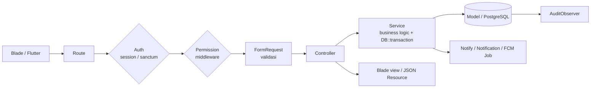
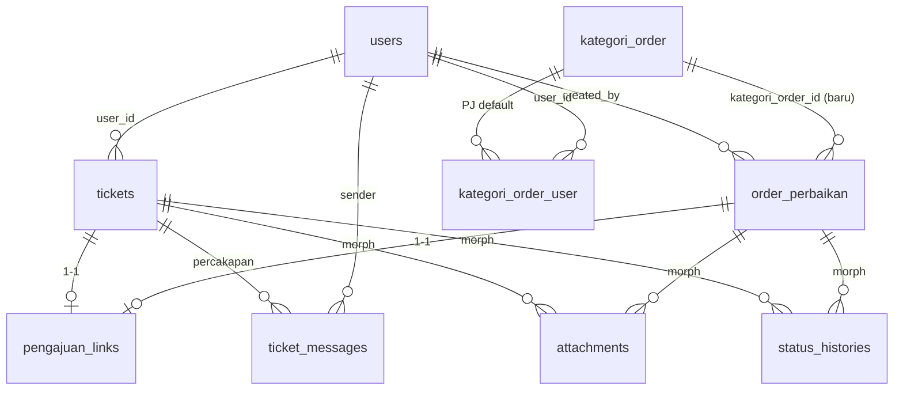
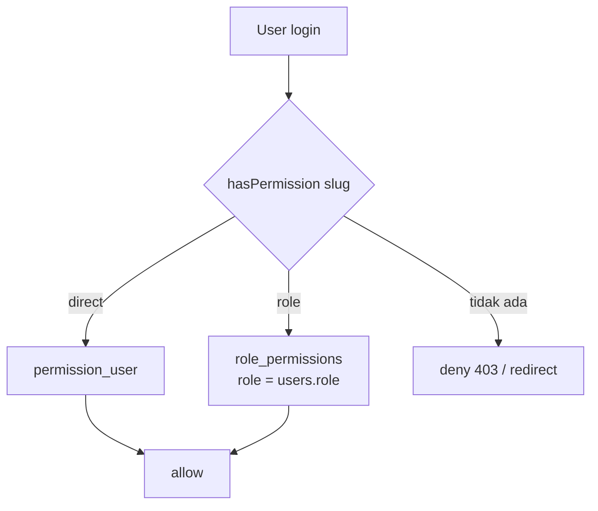
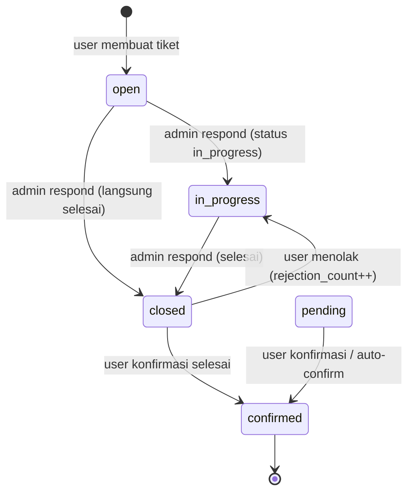
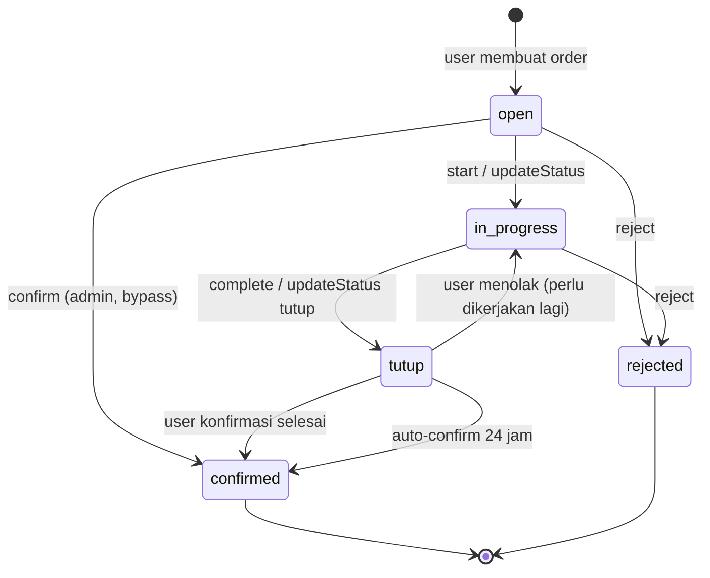
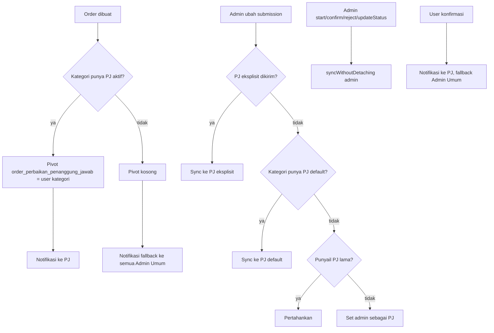

# Database Design & Struktur Logic — Helpdesk RS Azra

> Dokumen ini adalah hasil analisa langsung terhadap kode dan database **live** `db_helpdesk`
> (PostgreSQL 14.5) per **6 November 2026**. Isinya: kondisi saat ini (as-is), rancangan
> database (data dictionary, ERD, constraint, index), rancangan target (to-be), serta
> struktur logic aplikasi beserta temuan dan rekomendasi perbaikannya.
>
> Ruang lingkup: `app/`, `routes/`, `database/migrations/`, dan 38 tabel di schema `public`.

---

## 1. Ringkasan Eksekutif

Aplikasi Helpdesk RS Azra melayani **dua domain pengajuan** dalam satu aplikasi:

| Domain | Unit | Tabel utama | Pelaksana | Shell UI |
|---|---|---|---|---|
| Tiket IT | SIRS | `tickets`, `ticket_photos`, `ticket_penanggung_jawab` | Admin IT | biru (`dashboard.it`) |
| Order Perbaikan | IPSRS / Administrasi Umum | `order_perbaikan`, `order_perbaikan_histories`, `order_perbaikan_penanggung_jawab` | PJ kategori / Admin Umum | hijau (`dashboard.ipsrs`) |
| Pengajuan gabungan | lintas unit | `pengajuan_links` | keduanya | — |

Keduanya memakai master data bersama (departemen, gedung, lokasi, kategori, unit proses,
pengguna), RBAC berbasis permission, notifikasi in-app + FCM, dan audit log otomatis.

**Kekuatan desain saat ini**

- Pemisahan controller/service cukup konsisten; web dan API memakai service yang sama.
- RBAC berbasis tabel (`roles`, `permissions`, pivot role/user) dan fail-closed.
- Semua perubahan multi-tabel dibungkus `DB::transaction`.
- Ada audit observer otomatis untuk seluruh model.
- Ada konsep PJ (penanggung jawab) per kategori dan sinkronisasi dua arah tiket ↔ order.

**Temuan paling penting**

| # | Severity | Temuan | Dampak |
|---|---|---|---|
| 1 | Kritis | `order_perbaikan_histories.created_by` **NOT NULL**, tetapi auto-confirm & sinkron sistem menulis `created_by = null` | Proses auto-confirm order gagal (SQL error) |
| 2 | Kritis | Tiket memakai dua istilah status untuk hal yang sama: `pending` vs `closed` | Auto-confirm tiket tidak pernah jalan; popup konfirmasi tidak muncul |
| 3 | Tinggi | Nyaris tidak ada index sekunder di tabel domain | Query list/filter/statistik makin lambat seiring data |
| 4 | Tinggi | `kategori_order.name` tidak unik, padahal dipakai sebagai join key (`kategori_order_user`, `order_perbaikan.kategori_order`, `pengajuan_links`) | Duplikat/rename kategori memutus PJ & link |
| 5 | Tinggi | `order_perbaikan.foto` dan `order_perbaikan_histories.lampiran` bertipe `varchar(255)` tetapi di-cast array (JSON) | Path panjang/3 foto bisa terpotong / error |
| 6 | Tinggi | Penomoran tiket & order memakai pola `MAX(nomor)+1` tanpa lock | Race condition → duplicate key / 500 saat bersamaan |
| 7 | Sedang | Transisi status order tidak divalidasi (method `confirm/reject/start/updateStatus` bisa dipanggil dari status apa pun) | Data status tidak konsisten |
| 8 | Sedang | Kolom yang ditulis controller tetapi tidak ada di DB (`tickets.admin_confirmation*`) dan kolom mati (`opened_at`, `confirmed_at`, `rejection_notes`, dll.) | Fitur tidak berjalan / membingungkan |
| 9 | Sedang | `OrderPerbaikanService::update()` tidak mengosongkan PJ lama saat kategori baru tidak punya PJ | PJ salah tetap menerima order |
| 10 | Sedang | Tabel legacy `orders`, `order_photos`, `order_barang` masih ada (0 baris) | Beban kognitif & risiko salah pakai |

---

## 2. Stack & Arsitektur Aplikasi

### 2.1 Stack

| Komponen | Teknologi |
|---|---|
| Framework | Laravel 12 (PHP 8.x) |
| Database | PostgreSQL 14.5 — `db_helpdesk` @ `127.0.0.1:5432` |
| Auth web | Session guard (`users`) |
| Auth API | Laravel Sanctum (`personal_access_tokens`, Bearer token) |
| UI web | Blade + Tailwind (dua shell: user & admin) |
| Mobile | Flutter (konsumen REST API `/api/*`) |
| Queue | Database queue (`jobs`, `failed_jobs`) untuk FCM |
| Notifikasi | Laravel Database Notifications + Firebase Cloud Messaging |
| Audit | Observer otomatis → `audit_logs` |

### 2.2 Struktur folder inti

```
app/
├── Models/                  # Eloquent (User, Ticket, OrderPerbaikan, KategoriOrder, ...)
├── Services/
│   ├── Api/                 # TicketService, OrderPerbaikanService, PjScopeService, ...
│   ├── Access/              # RoleService, PermissionService
│   ├── Notifications/       # FirebaseNotificationService
│   ├── Monitoring/
│   ├── DepartmentService.php
│   └── PengajuanSinkronService.php   # integrasi tiket ↔ order
├── Http/
│   ├── Controllers/
│   │   ├── Admin/           # shell admin (tiket IT, master, user, report, audit, FCM)
│   │   ├── AdministrasiUmum/# shell admin (order perbaikan/IPSRS)
│   │   ├── User/            # shell user (tiket, order, profil, notifikasi)
│   │   ├── Auth/
│   │   └── Api/             # kontrak Flutter (Admin/, User/)
│   ├── Middleware/          # CheckPermission, AdminApiMiddleware, AdministrasiUmumApiMiddleware
│   ├── Requests/            # validasi per aksi
│   └── Resources/Api/       # bentuk JSON (TicketResource, OrderPerbaikanResource, ...)
├── Observers/AuditObserver.php
├── Notifications/           # notifikasi database
├── Jobs/Notifications/      # queue FCM
└── Support/Notifications/Notify.php

routes/web.php     # Blade
routes/api.php     # Flutter
routes/console.php # scheduler
```

### 2.3 Alur request (layer)



**Prinsip yang sudah dipakai**

- Controller tipis; logic bisnis utama ada di `app/Services`.
- Validasi terpusat di `FormRequest`.
- Respons API memakai envelope `success / message / data / meta`.
- Perubahan multi-tabel memakai transaksi; notifikasi dikirim setelah commit.

**Kelemahan struktur**

- `OrderPerbaikanPjScopeService` mewarisi `OrderPerbaikanService` dan **menyalin ulang**
  seluruh logika filter `listForAdmin` — duplikasi rawan divergen.
- Web dan API memiliki controller berbeda tetapi memanggil service yang sama; sebagian
  aturan (mis. `can_edit`) ditulis ulang di Resource.
- Belum ada layer `Policy`/`Enum`/`State Machine`; aturan transisi status tersebar di
  beberapa method dan controller.

### 2.4 Dua shell UI

| Shell | Syarat akses | Menu utama |
|---|---|---|
| User | login | dashboard user, Tiket Saya, Order Saya, knowledge, notifikasi, profil |
| Admin | permission `layout.admin` | dashboard IT/IPSRS, tiket, order, master data, user, permission, report, audit, FCM |

Redirect `/dashboard` memilih tujuan berdasarkan permission: `dashboard.it` → admin IT,
`dashboard.ipsrs` → IPSRS, selain itu → user.

---

## 3. Database Design (As-Is)

### 3.1 Konvensi

- Nama tabel **plural** untuk tabel framework, **singular** untuk tabel domain
  (`tickets`, `users` vs `order_perbaikan`, `kategori_order`). Tidak konsisten, tetapi
  dipertahankan karena sudah dipakai luas.
- Primary key: `bigint identity` (kecuali `notifications` memakai UUID).
- Timestamp: `created_at`, `updated_at` tanpa timezone (`timestamp(0)`).
- Soft delete: `tickets`, `order_perbaikan`, `kategori_order`, `unit_proses`.
- Enum domain memakai `varchar + CHECK constraint` (bukan tipe ENUM PostgreSQL).
- Nama kolom status/prioritas **tidak seragam**: tiket lowercase Inggris
  (`low/medium/high`), order uppercase Indonesia (`RENDAH/SEDANG/TINGGI/URGENT`) dan
  status `tutup` bercampur dengan `open/in_progress`.

### 3.2 Peta tabel (38 tabel)

| Grup | Tabel |
|---|---|
| Auth & RBAC | `users`, `roles`, `permissions`, `role_permissions`, `permission_user`, `personal_access_tokens`, `password_reset_tokens`, `sessions` |
| Master data | `departments`, `buildings`, `locations`, `categories`, `unit_proses`, `positions` |
| Tiket IT | `tickets`, `ticket_photos`, `ticket_penanggung_jawab` |
| Order IPSRS | `order_perbaikan`, `order_perbaikan_histories`, `order_perbaikan_penanggung_jawab`, `kategori_order`, `kategori_order_user` |
| Integrasi | `pengajuan_links` |
| Notifikasi | `notifications`, `notification_settings`, `device_tokens` |
| Audit & pendukung | `audit_logs`, `feedback`, `reports` |
| Legacy (0 baris) | `orders`, `order_photos`, `order_barang` |
| Framework | `cache`, `cache_locks`, `jobs`, `job_batches`, `failed_jobs`, `migrations` |

### 3.3 ERD as-is

```mermaid
erDiagram
    roles ||--o{ users : "role = slug"
    users ||--o{ tickets : "user_id"
    users ||--o{ order_perbaikan : "created_by"
    users o|--o{ order_perbaikan : "updated_by"
    users ||--o{ device_tokens : "user_id"
    users ||--o{ audit_logs : "user_id"
    users ||--o{ feedback : "user_id"
    users ||--o{ reports : "user_id"

    permissions ||--o{ role_permissions : "permission_id"
    permissions ||--o{ permission_user : "permission_id"
    users ||--o{ permission_user : "user_id"

    departments ||--o{ users : "department_id"
    departments }o--|| locations : "location_id"
    departments }o--|| buildings : "building_id"
    unit_proses ||--o{ categories : "unit_proses_id"

    categories ||--o{ tickets : "category_id"
    departments ||--o{ tickets : "department_id"
    buildings o|--o{ tickets : "building_id"
    locations o|--o{ tickets : "location_id"
    tickets ||--o{ ticket_photos : "ticket_id"
    tickets ||--o{ ticket_penanggung_jawab : "ticket_id"
    users ||--o{ ticket_penanggung_jawab : "user_id"

    order_perbaikan ||--o{ order_perbaikan_histories : "order_perbaikan_id"
    order_perbaikan ||--o{ order_perbaikan_penanggung_jawab : "order_perbaikan_id"
    users ||--o{ order_perbaikan_penanggung_jawab : "user_id"
    departments o|--o{ order_perbaikan : "department_id"
    locations o|--o{ order_perbaikan : "lokasi"

    kategori_order ||--o{ kategori_order_user : "kategori_order_id"
    users ||--o{ kategori_order_user : "user_id"
    kategori_order ||..o{ order_perbaikan : "nama (string, bukan FK)"

    tickets ||--o| pengajuan_links : "ticket_id (unique)"
    order_perbaikan ||--o| pengajuan_links : "order_perbaikan_id (unique)"
    users o|--o{ pengajuan_links : "created_by"

    users ||--o| notification_settings : "notifiable"
    users ||..o{ notifications : "notifiable (morph)"
    audit_logs }o--|| users : "user_id (nullable)"
```



> Catatan: garis putus-putus = relasi logis tanpa foreign key (join berdasarkan nama).

### 3.4 Data Dictionary

#### a) `users`

| Kolom | Tipe | Null | Default | Keterangan |
|---|---|---|---|---|
| `id` | bigint | no | identity | PK |
| `name` | varchar | no | — | Nama lengkap |
| `username` | varchar | yes | null | **Unique**, alternatif login |
| `email` | varchar | no | — | **Unique**, identitas utama |
| `phone` | varchar | yes | null | Diisi NIP saat import SIMUTU |
| `position` | varchar | yes | null | Kode posisi legacy (`STAFF`, `MANAGER`, `DIR_UT`) — **bukan FK** ke `positions` |
| `department` | varchar | yes | null | Nama/kode departemen legacy — **bukan FK** |
| `department_id` | bigint | yes | null | FK → `departments.id` (NO ACTION) |
| `role` | varchar | no | `user` | FK → `roles.slug` (NO ACTION) |
| `status` | boolean | no | `1` | Aktif/nonaktif |
| `email_verified_at` | timestamp | yes | null | — |
| `password` | varchar | no | — | Bcrypt |
| `remember_token` | varchar | yes | null | — |
| `fcm_token` | varchar | yes | null | Token FCM legacy (single device) |
| `fcm_token_updated_at` | timestamp | yes | null | — |
| `created_at`, `updated_at` | timestamp | yes | null | — |

Relasi model: `roleModel()` (belongsTo `roles.slug`), `permissions()` (belongsToMany
`permission_user`), `deviceTokens()`, `notificationSetting()` (morphOne),
`ticket`/`order` lewat tabel masing-masing.

> **Dualisme data**: `department` (string) dan `department_id` (FK) hidup berdampingan.
> `DepartmentService::resolveForUser()` mencoba `department_id` → `code` → `name` →
> case-insensitive, dan **bisa auto-create** departemen dari string. Ini sumber data ganda.

#### b) `roles`, `permissions`, pivot

| Tabel | Kolom penting | Constraint |
|---|---|---|
| `roles` | `id`, `slug` (unique), `name`, `description` | — |
| `permissions` | `id`, `name`, `slug` (unique), `group` (indexed), `description` | — |
| `role_permissions` | `id`, `role` (varchar), `permission_id` | FK permission cascade; unique (`role`, `permission_id`) |
| `permission_user` | `id`, `user_id`, `permission_id` | FK user cascade, FK permission cascade; unique (`user_id`, `permission_id`) |

Role kanonis (seeder): `user`, `admin` (Admin IT/SIRS), `ipsrs` (Admin IPSRS/Administrasi Umum).

Permission kanonis (18, seeder):

| Group | Slug |
|---|---|
| Tiket IT | `ticket` |
| Maintenance | `order`, `order.view_all` |
| Master | `master` |
| User Management | `user`, `permission` |
| Reports | `report`, `audit`, `report.sirs` |
| Feedback | `feedback` |
| Knowledge | `knowledge` |
| Notifications | `notification`, `fcm` |
| Admin | `dashboard.it`, `dashboard.ipsrs`, `layout.admin` |
| Tiket & Order Saya | `myticket`, `myorder` |

> `order.view_all` di-seed tetapi **tidak dipakai** di route/query mana pun. Scoping order
> admin sepenuhnya ditentukan oleh assignment PJ kategori (`OrderPerbaikanPjScopeService`).

#### c) Master data

| Tabel | Kolom | FK / Constraint |
|---|---|---|
| `buildings` | `id`, `name`, `code` (unique), `status`, timestamps | — |
| `locations` | `id`, `name`, `status`, timestamps | Tidak ada `building_id` (sudah dihapus) |
| `departments` | `id`, `name`, `code` (unique), `status`, `location_id`, `building_id`, timestamps | FK location/building `SET NULL` |
| `categories` | `id`, `name`, `status`, `unit_proses_id`, timestamps | FK `unit_proses` `SET NULL`; **tanpa soft delete** |
| `unit_proses` | `id`, `name`, `code` (unique), `status`, `deleted_at`, timestamps | SoftDeletes; `SIRS` = unit tiket IT |
| `positions` | `id`, `name`, `code` (unique), `status`, timestamps | Tidak dipakai sebagai FK `users.position` |

Aturan: tiket hanya boleh memakai kategori yang `unit_proses.code = 'SIRS'`; order
perbaikan tidak boleh memilih unit proses `SIRS`.

#### d) `tickets`

| Kolom | Tipe | Null | Default | Keterangan |
|---|---|---|---|---|
| `id` | bigint | no | identity | PK |
| `ticket_number` | varchar | no | — | **Unique**, format `T-{ddmm}-{seq3}` |
| `user_id` | bigint | no | — | FK users cascade (pembuat) |
| `category_id` | bigint | no | — | FK categories restrict |
| `category` | varchar | no | — | **Snapshot nama kategori** |
| `department_id` | bigint | **no** | — | FK departments restrict |
| `department` | varchar | no | — | Snapshot nama departemen |
| `building_id` | bigint | yes | null | FK buildings restrict |
| `building` | varchar | yes | null | Snapshot |
| `location_id` | bigint | yes | null | FK locations restrict |
| `location` | varchar | yes | null | Snapshot |
| `description` | text | no | — | Keluhan |
| `priority` | varchar | no | `low` | CHECK `low/medium/high` |
| `status` | varchar | no | `open` | CHECK `pending/open/in_progress/closed/confirmed` |
| `admin_notes` | text | yes | null | **Tidak dipakai** service |
| `opened_at` | timestamp | yes | null | **Tidak pernah diisi** |
| `in_progress_at` | timestamp | yes | null | Diisi saat admin respond `in_progress` |
| `closed_at` | timestamp | yes | null | Diisi saat admin respond `closed` |
| `confirmed_at` | timestamp | yes | null | **Tidak dipakai** |
| `rejection_notes` / `rejection_photo` | text/varchar | yes | null | **Tidak dipakai** (data ada di JSON) |
| `last_rejection_at` | timestamp | yes | null | Diisi saat user menolak |
| `rejection_count` | int | no | `0` | Counter penolakan user |
| `confirmation_notes` / `confirmation_photo` | text/varchar | yes | null | **Tidak dipakai** |
| `user_confirmation` | boolean | no | `false` | true = user sudah konfirmasi |
| `user_confirmed_at` | timestamp | yes | null | — |
| `user_confirmation_notes` | text | yes | null | **Tidak dipakai** |
| `photo` | varchar | yes | null | Legacy, foto utama ada di `ticket_photos` |
| `user_replies` | json | yes | null | Array balasan/konfirmasi user (termasuk foto) |
| `admin_responses` | json | yes | null | Array balasan admin (termasuk status & foto) |
| `created_at`, `updated_at`, `deleted_at` | timestamp | yes | null | SoftDeletes |

Relasi: `user`, `categoryRelation`, `departmentRelation`, `buildingRelation`,
`locationRelation`, `photos`, `initialPhoto`, `adminResponsePhotos`, `penanggungJawab`,
`pengajuanLink`.

#### e) `ticket_photos` & `ticket_penanggung_jawab`

| Tabel | Kolom | Constraint |
|---|---|---|
| `ticket_photos` | `id`, `ticket_id`, `photo_path`, `type`, timestamps | FK ticket cascade; CHECK type `initial/admin_response/user_response/user_rejection` |
| `ticket_penanggung_jawab` | `id`, `ticket_id`, `user_id`, timestamps | FK keduanya cascade; unique (`ticket_id`, `user_id`) |

#### f) `order_perbaikan`

| Kolom | Tipe | Null | Default | Keterangan |
|---|---|---|---|---|
| `id` | bigint | no | identity | PK |
| `nomor` | varchar | no | — | **Unique**, `OP/RTG/MTC-YYYYMMDD###` |
| `tanggal` | timestamp | no | — | Tanggal pengajuan |
| `nama_peminta` | varchar | no | — | Selalu nama user pembuat |
| `department_id` | bigint | yes | null | FK departments `SET NULL` |
| `kategori_order` | varchar | yes | null | **Nama kategori (join key, bukan FK)** |
| `lokasi` | bigint | yes | null | FK locations NO ACTION (nama kolom tidak `location_id`) |
| `gedung` | varchar | yes | null | Snapshot nama gedung |
| `keluhan` | text | no | — | Deskripsi kerusakan |
| `prioritas` | varchar | no | — | CHECK `RENDAH/SEDANG/TINGGI/URGENT` |
| `foto` | varchar(255) | yes | null | Di-cast `array`; menyimpan JSON path (risiko) |
| `status` | varchar | no | `open` | CHECK `open/in_progress/tutup/confirmed/rejected` |
| `follow_up` | text | yes | null | Catatan status terakhir |
| `created_by` | bigint | no | — | FK users NO ACTION (pembuat) |
| `updated_by` | bigint | yes | null | FK users NO ACTION (aktor terakhir) |
| `closed_at` | timestamp | yes | null | Diisi saat status `tutup` |
| `created_at`, `updated_at`, `deleted_at` | timestamp | yes | null | SoftDeletes |

Relasi: `history`, `creator`, `updater`, `department`, `location` (FK `lokasi`),
`penanggungJawab`, `kategoriOrderRef` (belongsTo by **name**), `pengajuanLink`.

#### g) `order_perbaikan_histories`

| Kolom | Tipe | Null | Keterangan |
|---|---|---|---|
| `id` | bigint | no | PK |
| `order_perbaikan_id` | bigint | no | FK cascade |
| `status` | varchar | no | CHECK 5 status order |
| `follow_up` | text | yes | Catatan tindak lanjut |
| `keterangan` | text | yes | Deskripsi aktivitas |
| `lampiran` | varchar(255) | yes | Di-cast array; JSON path (risiko) |
| `created_by` | bigint | **no** | FK users; **penyebab bug auto-confirm** |
| `created_at`, `updated_at` | timestamp | yes | — |

#### h) `order_perbaikan_penanggung_jawab`

`id`, `order_perbaikan_id` (FK cascade), `user_id` (FK cascade), timestamps,
unique (`order_perbaikan_id`, `user_id`).

#### i) `kategori_order` & assignment PJ

| Tabel | Kolom | Constraint |
|---|---|---|
| `kategori_order` | `id`, `name`, `code` (unique, nullable), `status`, `deleted_at`, timestamps | SoftDeletes; **`name` tidak unik** |
| `kategori_order_user` | `id`, `kategori_order_id`, `user_id`, timestamps | FK keduanya cascade; unique (`kategori_order_id`, `user_id`) |

`kategori_order_user` = daftar user yang menjadi **PJ default** untuk kategori tersebut.
Assignment **tidak membatasi** user yang boleh memilih kategori (lihat
`KategoriOrderAllowed`).

#### j) `pengajuan_links`

| Kolom | Tipe | Keterangan |
|---|---|---|
| `id` | bigint | PK |
| `ticket_id` | bigint | FK tickets cascade, **unique** |
| `order_perbaikan_id` | bigint | FK order cascade, **unique** |
| `kategori_name` | varchar | Nama kategori penghubung (mis. `TV`) |
| `sync_enabled` | boolean | Default true |
| `created_by` | bigint | FK users `SET NULL` |
| timestamps | — | — |

Satu tiket maksimal terhubung ke satu order, dan sebaliknya (relasi 1‑1).

#### k) Notifikasi & perangkat

| Tabel | Kolom | Keterangan |
|---|---|---|
| `notifications` | `id` (uuid PK), `type`, `notifiable_type`, `notifiable_id`, `data` (text), `read_at`, timestamps | Index morph; `data` JSON string |
| `notification_settings` | `id`, `notifiable_type`, `notifiable_id`, `read_expiry_days` (7), `unread_expiry_days` (30), `auto_delete_read` (true), `auto_delete_unread` (false), timestamps | Pengaturan retensi per user |
| `device_tokens` | `id`, `user_id`, `token` (unique), `platform`, `is_valid`, `last_used_at`, timestamps | Index (`user_id`, `is_valid`) |

`User::getAllFcmTokens()` menggabungkan `device_tokens` yang valid + `users.fcm_token`
legacy.

#### l) `audit_logs`, `feedback`, `reports`

| Tabel | Kolom penting | Catatan |
|---|---|---|
| `audit_logs` | `id`, `user_id` (FK SET NULL), `auditable_type`, `auditable_id`, `event`, `old_values` (json), `new_values` (json), `url`, `ip_address(45)`, `user_agent`, timestamps | Index morph, user, event, created_at |
| `feedback` | `id`, `user_id` (cascade), `rating`, `category`, `subject`, `message`, `admin_reply`, `replied_at`, timestamps | — |
| `reports` | `id`, `user_id` (cascade), `type`, `description`, `screenshot`, timestamps | Model `fillable` memuat `status`, **kolom tidak ada** |

#### m) Tabel legacy (0 baris)

`orders` (order lama dengan `unit_proses_code`, `prioritas BIASA/OCTO`),
`order_photos`, `order_barang` (permintaan barang). Tidak dipakai kode aktif; kandidat drop.

### 3.5 CHECK constraint & enum

| Tabel.kolom | Nilai valid |
|---|---|
| `tickets.priority` | `low`, `medium`, `high` |
| `tickets.status` | `pending`, `open`, `in_progress`, `closed`, `confirmed` |
| `ticket_photos.type` | `initial`, `admin_response`, `user_response`, `user_rejection` |
| `order_perbaikan.prioritas` | `RENDAH`, `SEDANG`, `TINGGI/URGENT` |
| `order_perbaikan.status` | `open`, `in_progress`, `tutup`, `confirmed`, `rejected` |
| `order_perbaikan_histories.status` | sama dengan order |
| `orders.prioritas` (legacy) | `BIASA`, `OCTO` |
| `orders.jenis_barang` (legacy) | `Inventaris`, `Umum` |
| `order_barang.status` (legacy) | `pending`, `approved`, `rejected` |

### 3.6 Index & FK saat ini

- Semua tabel domain hanya memiliki **PK + unique index** (ditambah index morph
  `notifications`, `device_tokens(user_id,is_valid)`, `audit_logs`, `permissions.group`).
- **Tidak ada index** untuk kolom yang paling sering difilter:
  `tickets(user_id, status, created_at, category_id, department_id)`,
  `order_perbaikan(created_by, status, tanggal, kategori_order, department_id)`,
  `order_perbaikan_histories(order_perbaikan_id)`,
  pivot `user_id`, `notifications(notifiable_type, notifiable_id, read_at)`.
- FK `created_by`/`updated_by` order dan `users.role` memakai **NO ACTION**, sehingga
  penghapusan user/role bisa terblokir. `tickets.user_id` memakai **CASCADE** (hapus user =
  hapus tiket — berisiko untuk histori).

---

## 4. Database Design (To-Be / Rekomendasi)

### 4.1 Prinsip target

1. **Satu istilah untuk satu status**; transisi divalidasi di kode (enum + transition map).
2. **FK untuk relasi**, snapshot nama hanya untuk histori/tampilan.
3. **JSON hanya untuk data yang benar-benar fleksibel**; gunakan `jsonb`, bukan `varchar`.
4. **Media terpusat** di tabel `attachments` (morph), bukan JSON path bertebaran.
5. **Index sesuai pola query** (list, filter status/tanggal, dashboard, notifikasi).
6. **Aktor sistem eksplisit** (nullable actor atau system user), bukan `null` yang
   melanggar NOT NULL.
7. **Penomoran atomic** (tabel sequence per hari + row lock).
8. **Soft delete konsisten** untuk user & master yang direferensikan.

### 4.2 ERD target



### 4.3 Perubahan skema prioritas

#### P0 — perbaikan correctness (wajib sebelum go-live berikutnya)

| # | Perubahan | Alasan |
|---|---|---|
| P0-1 | `order_perbaikan_histories.created_by` → **nullable** + kolom `actor_type` (`user`/`system`) | Auto-confirm & sinkron sistem menulis null |
| P0-2 | Kanoniskan status tiket: gunakan `closed` = menunggu konfirmasi, `confirmed` = selesai; **hapus pemakaian `pending`** dari query/UI (atau migrasi `pending` → `closed`) | Auto-confirm & popup konsisten |
| P0-3 | Unique index `kategori_order (lower(name)) WHERE deleted_at IS NULL` | Nama adalah join key |
| P0-4 | Tambah `kategori_order_id` FK + backfill dari nama; pertahankan `kategori_order` sebagai snapshot | Integritas relasi |
| P0-5 | `order_perbaikan.foto` & `histories.lampiran` → `jsonb` (atau pindah ke `attachments`) | Cast array vs varchar(255) |
| P0-6 | Tambah index sekunder (lihat 4.4) | Performa list/dashboard |
| P0-7 | Ganti FK `created_by`/`updated_by` order menjadi `ON DELETE SET NULL`; tambah `users.deleted_at` | Menghindari blokir hapus user |
| P0-8 | Perbaiki penomoran atomic (`daily_sequences`) | Race condition |

#### P1 — konsistensi & maintainability

| # | Perubahan |
|---|---|
| P1-1 | Hapus/isi kolom mati: `tickets.opened_at`, `confirmed_at`, `admin_notes`, `photo`, `rejection_notes`, `rejection_photo`, `confirmation_notes`, `confirmation_photo`, `user_confirmation_notes`; atau implementasikan |
| P1-2 | Tambah kolom yang dipakai controller: `tickets.admin_confirmation`, `admin_confirmed_at`, `admin_confirmation_notes` (atau hapus method `confirm`) |
| P1-3 | Hapus `categories.parent_id`/`children()` dari model (kolom tidak ada) dan `reports.status` |
| P1-4 | `notifications.data` → `jsonb`; unique `notification_settings(notifiable_type, notifiable_id)` |
| P1-5 | Samakan `tickets.department_id` nullable atau wajibkan `order.department_id` |
| P1-6 | `positions` → FK `users.position_id` (setelah backfill kode) dan deprecate `users.position` |
| P1-7 | Deprecate `users.department` string setelah backfill `department_id` |
| P1-8 | Hapus tabel legacy `orders`, `order_photos`, `order_barang` |
| P1-9 | Tambah `updated_by` di `tickets` (opsional; audit sudah mencatat) |

#### P2 — desain jangka panjang

| # | Perubahan |
|---|---|
| P2-1 | Tabel `attachments` (morph) menggantikan `ticket_photos` + JSON foto/lampiran |
| P2-2 | Tabel `status_histories` (morph) menggantikan `order_perbaikan_histories`, `admin_responses`, `user_replies` |
| P2-3 | Tabel `ticket_messages` untuk percakapan (query, pagination, read status) |
| P2-4 | Tabel `daily_sequences` untuk nomor tiket/order |
| P2-5 | Partisi `audit_logs` & `notifications` per bulan bila volume > 5 juta |
| P2-6 | Full-text search (`pg_trgm` GIN) untuk `keluhan`, `description`, nama peminta |

### 4.4 DDL rekomendasi (siap dijadikan migration baru)

> Jalankan di migration **baru** (jangan mengubah migration yang sudah jalan).
> Untuk index di produksi, buat dengan `CREATE INDEX CONCURRENTLY` di luar transaksi.
> Nama constraint di bawah mengikuti konvensi Laravel; verifikasi dulu dengan
> `\d+ order_perbaikan` karena nama aktual bisa berbeda. Uji klausa `USING` JSONB pada
> salinan data sebelum diterapkan di produksi.

```sql
-- P0-1: aktor sistem
ALTER TABLE order_perbaikan_histories ALTER COLUMN created_by DROP NOT NULL;
ALTER TABLE order_perbaikan_histories
    ADD COLUMN actor_type varchar(10) NOT NULL DEFAULT 'user';
ALTER TABLE order_perbaikan_histories
    ADD CONSTRAINT order_histories_actor_type_check
    CHECK (actor_type IN ('user', 'system'));

-- P0-2: kanonisasi status tiket (opsional: migrasi data dulu)
UPDATE tickets SET status = 'closed'
WHERE status = 'pending' AND user_confirmation = false;

-- P0-3: nama kategori unik (case-insensitive, hanya yang aktif)
CREATE UNIQUE INDEX kategori_order_name_active_unique
    ON kategori_order (lower(name))
    WHERE deleted_at IS NULL;

-- P0-4: FK kategori order
ALTER TABLE order_perbaikan
    ADD COLUMN kategori_order_id bigint
    REFERENCES kategori_order(id) ON DELETE SET NULL;

UPDATE order_perbaikan o
SET kategori_order_id = k.id
FROM kategori_order k
WHERE lower(k.name) = lower(o.kategori_order)
  AND k.deleted_at IS NULL;

CREATE INDEX order_perbaikan_kategori_order_id_idx
    ON order_perbaikan (kategori_order_id);

-- P0-5: JSONB untuk foto/lampiran
ALTER TABLE order_perbaikan
    ALTER COLUMN foto TYPE jsonb
    USING CASE
        WHEN foto IS NULL THEN NULL
        WHEN foto ~ '^\s*[\[\{]' THEN foto::jsonb
        ELSE to_jsonb(foto)
    END;

ALTER TABLE order_perbaikan_histories
    ALTER COLUMN lampiran TYPE jsonb
    USING CASE
        WHEN lampiran IS NULL THEN NULL
        WHEN lampiran ~ '^\s*[\[\{]' THEN lampiran::jsonb
        ELSE to_jsonb(lampiran)
    END;

-- P0-6: index operasional
CREATE INDEX tickets_user_status_created_idx
    ON tickets (user_id, status, created_at DESC);
CREATE INDEX tickets_status_created_idx
    ON tickets (status, created_at DESC)
    WHERE deleted_at IS NULL;
CREATE INDEX tickets_department_status_idx
    ON tickets (department_id, status);
CREATE INDEX tickets_category_idx
    ON tickets (category_id);

CREATE INDEX order_perbaikan_created_status_idx
    ON order_perbaikan (created_by, status, created_at DESC);
CREATE INDEX order_perbaikan_status_tanggal_idx
    ON order_perbaikan (status, tanggal DESC)
    WHERE deleted_at IS NULL;
CREATE INDEX order_perbaikan_kategori_status_idx
    ON order_perbaikan (kategori_order, status)
    WHERE deleted_at IS NULL;
CREATE INDEX order_histories_order_created_idx
    ON order_perbaikan_histories (order_perbaikan_id, created_at);

CREATE INDEX order_pj_user_idx
    ON order_perbaikan_penanggung_jawab (user_id);
CREATE INDEX ticket_pj_user_idx
    ON ticket_penanggung_jawab (user_id);
CREATE INDEX kategori_order_user_user_idx
    ON kategori_order_user (user_id);

CREATE INDEX notifications_notifiable_read_idx
    ON notifications (notifiable_type, notifiable_id, read_at);
CREATE UNIQUE INDEX notification_settings_notifiable_unique
    ON notification_settings (notifiable_type, notifiable_id);

-- P0-7: user soft delete + FK aman
ALTER TABLE users ADD COLUMN deleted_at timestamp NULL;
ALTER TABLE order_perbaikan DROP CONSTRAINT order_perbaikan_created_by_foreign;
ALTER TABLE order_perbaikan
    ADD CONSTRAINT order_perbaikan_created_by_foreign
    FOREIGN KEY (created_by) REFERENCES users(id) ON DELETE SET NULL;
ALTER TABLE order_perbaikan DROP CONSTRAINT order_perbaikan_updated_by_foreign;
ALTER TABLE order_perbaikan
    ADD CONSTRAINT order_perbaikan_updated_by_foreign
    FOREIGN KEY (updated_by) REFERENCES users(id) ON DELETE SET NULL;

-- P1-4: notifikasi JSONB
ALTER TABLE notifications
    ALTER COLUMN data TYPE jsonb
    USING data::jsonb;

-- P1-8: legacy cleanup (setelah backup)
-- DROP TABLE order_photos, order_barang, orders;
```

**Tabel penomoran atomic**

```sql
CREATE TABLE daily_sequences (
    scope       varchar(20) NOT NULL,   -- 'ticket' | 'order'
    seq_date    date        NOT NULL,
    last_number integer     NOT NULL DEFAULT 0,
    PRIMARY KEY (scope, seq_date)
);

-- Pemakaian (di dalam DB::transaction):
-- INSERT INTO daily_sequences (scope, seq_date, last_number)
-- VALUES ('order', CURRENT_DATE, 1)
-- ON CONFLICT (scope, seq_date)
-- DO UPDATE SET last_number = daily_sequences.last_number + 1
-- RETURNING last_number;
```

**Tabel target P2**

```sql
CREATE TABLE attachments (
    id            bigint GENERATED ALWAYS AS IDENTITY PRIMARY KEY,
    attachable_type varchar(255) NOT NULL,
    attachable_id   bigint       NOT NULL,
    type          varchar(30)    NOT NULL, -- initial/admin_response/user_response/...
    path          varchar(500)   NOT NULL,
    original_name varchar(255)   NULL,
    mime_type     varchar(100)   NULL,
    size_bytes    bigint         NULL,
    uploaded_by   bigint         NULL REFERENCES users(id) ON DELETE SET NULL,
    created_at    timestamp      NULL,
    updated_at    timestamp      NULL
);
CREATE INDEX attachments_morph_idx ON attachments (attachable_type, attachable_id);

CREATE TABLE status_histories (
    id            bigint GENERATED ALWAYS AS IDENTITY PRIMARY KEY,
    subject_type  varchar(255) NOT NULL,
    subject_id    bigint       NOT NULL,
    from_status   varchar(30)  NULL,
    to_status     varchar(30)  NOT NULL,
    notes         text         NULL,
    actor_id      bigint       NULL REFERENCES users(id) ON DELETE SET NULL,
    actor_name    varchar(255) NULL,       -- snapshot / "Sistem"
    actor_type    varchar(10)  NOT NULL DEFAULT 'user',
    metadata      jsonb        NULL,
    created_at    timestamp    NULL,
    updated_at    timestamp    NULL
);
CREATE INDEX status_histories_subject_idx
    ON status_histories (subject_type, subject_id, created_at);

CREATE TABLE ticket_messages (
    id         bigint GENERATED ALWAYS AS IDENTITY PRIMARY KEY,
    ticket_id  bigint NOT NULL REFERENCES tickets(id) ON DELETE CASCADE,
    sender_id  bigint NULL REFERENCES users(id) ON DELETE SET NULL,
    sender_role varchar(20) NOT NULL, -- user/admin/system
    message    text NOT NULL,
    created_at timestamp NULL,
    updated_at timestamp NULL
);
CREATE INDEX ticket_messages_ticket_idx ON ticket_messages (ticket_id, created_at);
```

### 4.5 Rencana migrasi bertahap

| Fase | Langkah | Risiko | Rollback |
|---|---|---|---|
| 0 | Backup DB + ukur row count; deploy index `CONCURRENTLY`; fix `created_by` nullable | Rendah | Drop index / set NOT NULL kembali (setelah data bersih) |
| 1 | Migrasi tiket `pending` → `closed`; update kode auto-confirm/popup/UI; tambah `kategori_order_id` + backfill | Sedang | Kembalikan status dari audit/histori; kolom baru bisa di-drop |
| 2 | Ubah `foto`/`lampiran` → jsonb (validasi data dulu); unique nama kategori setelah cek duplikat | Sedang | Simpan backup kolom lama; down migration mengembalikan text |
| 3 | Pindahkan media ke `attachments`; pindahkan timeline ke `status_histories`; refactor service | Tinggi | Dual-write periode transisi, lalu cutover |
| 4 | Hapus kolom/tabel legacy; tambah constraint & policy baru | Sedang | Restore dari backup |

**Aturan implementasi**

- Selalu `DB::transaction` untuk backfill per batch (mis. 500 baris).
- Jangan mengubah migration lama (sudah dijalankan di produksi).
- Untuk kolom baru wajib: isi default/backfill sebelum `SET NOT NULL`.
- Uji di salinan DB (`pg_dump` → restore) sebelum produksi.

---

## 5. Struktur Logic

### 5.1 Peta tanggung jawab layer

| Layer | Tanggung jawab | Contoh |
|---|---|---|
| Route | URL, method, middleware | `routes/web.php`, `routes/api.php` |
| Middleware | Auth, permission, gerbang domain | `CheckPermission`, `AdminApiMiddleware`, `AdministrasiUmumApiMiddleware` |
| FormRequest | Validasi input & otorisasi dasar | `StoreTicketRequest`, `UpdateOrderSubmissionRequest` |
| Controller | Orkestrasi request/response | `TicketAdminController`, `OrderPerbaikanController` |
| Service | Business rule, transaksi, notifikasi | `TicketService`, `OrderPerbaikanService`, `PengajuanSinkronService` |
| Model | Relasi, cast, scope, helper status | `Ticket`, `OrderPerbaikan`, `User` |
| Observer | Audit otomatis | `AuditObserver` |
| Notification/Job | Inbox DB & FCM | `TicketRespondedNotification`, `SendFirebaseNotificationJob` |
| Resource | Kontrak JSON | `TicketResource`, `OrderPerbaikanResource` |

### 5.2 RBAC & resolusi permission



- `User::hasPermission()` = permission langsung **ATAU** permission role; jika tidak ada
  baris yang cocok → **deny (fail-closed)**.
- `User::effectivePermissionSlugs()` = gabungan role + direct, dipakai `GET /api/auth/me`
  dan `/api/auth/permissions`.
- `isAdminIT()` = role `admin` **atau** punya `dashboard.it`.
- `isAdminUmum()` = role `ipsrs` **atau** punya `dashboard.ipsrs`.
- `scopeAdminIT()` / `scopeAdminUmum()` membentuk query penerima notifikasi.
- Web middleware `permission:slug` mendukung OR (`|`) dan AND (`,`).
- API admin memakai gerbang **domain** (`dashboard.it` / `dashboard.ipsrs`) lalu
  permission fitur. Jadi Admin IT tanpa `ticket` tetap tidak bisa mengelola tiket.

### 5.3 Scoping data

| Konteks | Aturan query | Implementasi |
|---|---|---|
| Tiket milik sendiri | `tickets.user_id = auth.id` | `TicketService::listForUser/allForUser` |
| Tiket admin | semua tiket (kecuali filter) | `TicketService::listForAdmin` |
| Order milik sendiri | `order_perbaikan.created_by = auth.id` | `listForUser(..., forceOwner: true)` |
| Order admin/PJ | kategori yang di-assign ke user; jika tidak punya assignment → order yang kategorinya **tidak punya PJ** | `OrderPerbaikanPjScopeService::applyPjScope` |
| Detail order (API user) | admin IT/IPSRS boleh lihat semua; selain itu hanya `created_by` | `Api\User\OrderPerbaikanController::show` |
| Detail tiket | admin bisa lihat; user hanya miliknya | controller + policy implisit |
| Master/user/permission | permission `master` / `user` / `permission` + `layout.admin` | route middleware |

### 5.4 Lifecycle Tiket IT

#### State machine (as-is)



> `pending` hanya muncul dari `TicketAdminController::updateStatus` (method tidak
> terdaftar di route) dan dari beberapa filter; jalur utama admin (`adminRespond`) menulis
> `closed`. Ini akar bug auto-confirm.

#### Aturan bisnis

| Kode | Aturan |
|---|---|
| T-01 | Kategori wajib berasal dari `unit_proses.code = 'SIRS'` |
| T-02 | User wajib punya departemen; departemen di-resolve dari `department_id`/`department` dan bisa auto-create |
| T-03 | Gedung default = gedung departemen; lokasi default = lokasi departemen; form boleh override |
| T-04 | Tiket baru: `status = open`, nomor `T-{ddmm}-{seq3}` |
| T-05 | Edit/hapus oleh user hanya saat `status = open` dan `user_id = auth.id` |
| T-06 | Admin respond mengisi `in_progress_at`/`closed_at`, menambah `admin_responses` JSON + `ticket_photos`, lalu notifikasi ke pemilik |
| T-07 | User confirm: status `confirmed`, `user_confirmation = true`, `user_confirmed_at = now`, tambah `user_replies` JSON |
| T-08 | User reject: status `in_progress`, `user_confirmation = false`, `rejection_count++`, `last_rejection_at = now` |
| T-09 | Auto-confirm setelah 24 jam: **seharusnya** `closed` + `user_confirmation = false` → `confirmed` |
| T-10 | Setiap perubahan status menyinkronkan tiket target ke order (jika ada link) |

#### Alur create tiket

```mermaid
sequenceDiagram
    actor U as User
    participant C as TicketController
    participant S as TicketService
    participant DB as PostgreSQL
    participant N as Notify/FCM
    participant SY as PengajuanSinkronService
    U->>C: POST /tiket (kategori SIRS, deskripsi, prioritas, foto)
    C->>S: create(user, data, photos)
    S->>S: resolve departemen/gedung/lokasi
    S->>DB: BEGIN; generate nomor; insert tickets; insert ticket_photos; COMMIT
    S->>N: notifikasi DB + FCM ke Admin IT
    S->>SY: createCounterpartForTicket()
    SY->>DB: (jika kategori target) insert order + pengajuan_links
    S-->>C: Ticket
    C-->>U: redirect / JSON 201
```

### 5.5 Lifecycle Order Perbaikan

#### State machine (as-is)



> Tidak ada validasi transisi: `start`, `confirm`, `reject`, `updateStatus` dapat
> dipanggil dari status mana pun.

#### Aturan bisnis

| Kode | Aturan |
|---|---|
| O-01 | Kategori order wajib ada & aktif (`KategoriOrderAllowed`), **tidak** dibatasi assignment |
| O-02 | Nomor `OP/RTG/MTC-YYYYMMDD###`, urut per hari |
| O-03 | `nama_peminta` = nama user pembuat; `created_by` = user |
| O-04 | Departemen diambil dari input/user; PJ default dari `kategori_order_user` |
| O-05 | Foto maksimal 3 file (request 2 MB/foto), disimpan di `order-photos` |
| O-06 | Order baru: `status = open` + history `open` |
| O-07 | Owner hanya bisa edit/hapus saat `open` |
| O-08 | Admin update submission: PJ eksplisit > PJ default kategori > PJ lama > admin |
| O-09 | `start` → `in_progress`, aktor otomatis ditambahkan sebagai PJ |
| O-10 | `updateStatus` `tutup` mengisi `closed_at`; follow-up masuk history |
| O-11 | `confirm` (admin) → `confirmed`; `reject` (admin) → `rejected` |
| O-12 | `userConfirm` hanya oleh owner dan hanya saat `tutup`; `selesai` → `confirmed`, `belum` → `in_progress` |
| O-13 | Auto-confirm 24 jam setelah `closed_at` → `confirmed` |
| O-14 | Notifikasi status ke pembuat; notifikasi order baru ke PJ (fallback semua Admin Umum) |

#### Alur create order + PJ + sinkron

```mermaid
sequenceDiagram
    actor U as User
    participant C as OrderPerbaikanController
    participant S as OrderPerbaikanService
    participant DB as PostgreSQL
    participant N as Notify/FCM
    participant SY as PengajuanSinkronService
    U->>C: POST /order-perbaikan
    C->>S: create(user, validated, foto)
    S->>DB: BEGIN; nomor; insert order; sync PJ kategori; history open; COMMIT
    S->>N: order_created ke PJ (fallback Admin Umum)
    S->>SY: createCounterpartForOrder()
    SY->>DB: (jika kategori target) insert tiket + link + salin foto
    S-->>C: Order
```

### 5.6 Logic PJ (Penanggung Jawab)



- `defaultPjIdsFor($kategori)` = `kategori_order_user` join `users.status = 1` untuk nama
  kategori aktif.
- Assignment kategori **tidak** membatasi pilihan kategori oleh user.
- Visibilitas daftar order admin: jika user punya assignment → hanya kategori itu; jika
  tidak → hanya order yang kategorinya tidak punya PJ (supaya Admin Umum tetap melihat
  order "tanpa PJ").
- **Bug**: pada `update()` oleh owner, bila kategori berubah ke kategori **tanpa PJ**,
  PJ lama tidak dibersihkan (hanya sync jika ada PJ baru).

### 5.7 Pengajuan gabungan (Tiket ↔ Order)

- Target sinkron: `PengajuanSinkronService::TARGET_KATEGORI = ['TV']` (hardcoded).
- Syarat: nama kategori ada di `TARGET_KATEGORI`, ada di `categories` aktif dengan unit
  **SIRS**, dan ada di `kategori_order` aktif (case-insensitive).
- Relasi 1‑1 disimpan di `pengajuan_links` (unique `ticket_id` dan
  `order_perbaikan_id`), dengan `sync_enabled`.
- Pembuatan pasangan:
  - Tiket target dibuat → order baru + salin foto `initial` + link.
  - Order target dibuat → tiket baru + salin foto order + link.
  - Guard statis `$creating` mencegah rekursi/ping-pong.
- Sinkron status dua arah (guard `$syncing`):

| Dari Tiket | Ke Order |
|---|---|
| `open` | `open` |
| `in_progress` | `in_progress` |
| `closed`, `pending` | `tutup` |
| `confirmed` | `confirmed` |
| lainnya | tidak disinkronkan |

| Dari Order | Ke Tiket |
|---|---|
| `open` | `open` |
| `in_progress` | `in_progress` |
| `tutup` | `closed` |
| `confirmed` | `confirmed` |
| `rejected` | `in_progress` (rejected tidak punya padanan) |

- Prioritas: tiket `high/medium/low` ↔ order `TINGGI/URGENT/SEDANG/RENDAH`.
- Sinkron menulis history/response dengan aktor; **jika aktor null (scheduler), terjadi
  pelanggaran NOT NULL** pada `order_perbaikan_histories.created_by`.
- `syncFromTicket` menulis `admin_responses` JSON dan (jika confirmed) mengisi
  `user_confirmation = true`, `user_confirmed_at = now`.

### 5.8 Penomoran

| Dokumen | Format | Sumber urutan | Risiko |
|---|---|---|---|
| Tiket | `T-{ddmm}-{seq3}` | `MAX(ticket_number LIKE 'T-{ddmm}-%')` | Collision antar tahun (tidak ada tahun), race condition |
| Order | `OP/RTG/MTC-{YYYYMMDD}{seq3}` | `MAX(nomor LIKE prefix%)` termasuk soft-deleted | Race condition; 3 digit = maks 999/hari |

Rekomendasi: `daily_sequences` + `lockForUpdate`/`ON CONFLICT` dalam transaksi yang sama
dengan insert dokumen; atau PostgreSQL advisory lock per prefix.

### 5.9 File & attachment

| Konteks | Lokasi | Metadata | Catatan |
|---|---|---|---|
| Foto tiket awal/balasan/respons | `storage/app/public/ticket-photos`, `ticket-replies`, `ticket-responses` | `ticket_photos` (type) | Maks 3 file; validasi tiket 5 MB (berbeda dengan order 2 MB) |
| Foto order | `storage/app/public/order-photos` | `order_perbaikan.foto` (JSON array) | varchar(255) → risiko; nama file memakai `time()` (bisa tabrakan) |
| Lampiran history order | `order-lampiran` | `order_perbaikan_histories.lampiran` (JSON array) | varchar(255) → risiko |
| Screenshot report | `storage` | `reports.screenshot` | — |

Rekomendasi: satu tabel `attachments` + validasi MIME/ukuran terpusat + nama file UUID +
penghapusan file saat record dihapus (saat ini `forceDelete` order menghapus foto hanya
jika berupa string).

### 5.10 Notifikasi

**Dua kanal:**

1. **Inbox DB** — tabel `notifications` (Laravel Notifiable), dibaca lewat halaman/API
   notifikasi; pengaturan retensi di `notification_settings`.
2. **FCM** — `Notify` membangun payload dan memanggil `FirebaseNotification::queue*`,
   diproses job `SendFirebaseNotificationJob` (queue database). Token diambil dari
   `device_tokens` valid + `users.fcm_token`.

**Matriks penerima:**

| Event | Penerima | Kanal |
|---|---|---|
| `ticket_created`, `ticket_replied`, `ticket_confirmed`, `ticket_rejected` | semua Admin IT (`scopeAdminIT`) | DB + FCM |
| `ticket_responded`, `ticket_updated`, `ticket_replied` (admin → user) | pemilik tiket | DB + FCM |
| `order_created` | PJ order; fallback semua Admin Umum | DB + FCM |
| `order_assigned` (PJ baru) | PJ yang ditambahkan | DB + FCM |
| `order_status_updated`, `order_started`, `order_confirmed`, `order_rejected` | pembuat order | DB + FCM |
| user konfirmasi order | PJ; fallback Admin Umum | DB |
| auto-confirm | pembuat + PJ/admin umum | DB + FCM |

Payload FCM menyertakan `type`, id, status, prioritas, dan `deep_link`
(`helpdesk://ticket/{id}` / `helpdesk://order/{id}`). Kegagalan FCM tidak menggagalkan
transaksi (di-log).

### 5.11 Audit log

- `AppServiceProvider::boot()` mendaftarkan `AuditObserver` ke **semua** model di
  `app/Models` (kecuali `AuditLog`).
- Event: `created`, `updated` (diff `getChanges`), `deleted`, `restored`.
- Field sensitif (`password`, `remember_token`, `updated_at`) dibuang.
- Konteks: `user_id` (`Auth::id()`), URL, IP, user agent.
- Operasi `DB::table()` (import/bulk) **tidak** teraudit; scheduler menghasilkan
  `user_id = null`.
- Kandidat optimasi: retensi/partisi, index `(auditable_type, auditable_id)` sudah ada.

### 5.12 Auto-confirm (scheduler)

```php
// routes/console.php
Schedule::command('pengajuan:auto-confirm')->hourly();
```

Command `pengajuan:auto-confirm --hours=24`:

- **Order**: `status = tutup` dan `closed_at <= now - 24h` → `confirmed`, tulis history,
  notifikasi pembuat + PJ. **Bug**: history `created_by = null` (NOT NULL).
- **Tiket**: `status = pending` dan `user_confirmation = false` dan `closed_at <= ...` →
  `confirmed`. **Bug**: jalur admin menulis `closed`, bukan `pending`, sehingga tiket
  tidak pernah tersapu.

Rekomendasi: satu definisi status "menunggu konfirmasi" (`closed`) untuk tiket dan
`tutup` untuk order; gunakan `actor_type = system` + `created_by = null` (setelah P0-1).

### 5.13 Alur admin respond tiket

```mermaid
sequenceDiagram
    actor A as Admin IT
    participant C as TicketAdminController
    participant S as TicketService
    participant DB as PostgreSQL
    participant N as Notify
    participant SY as PengajuanSinkronService
    A->>C: POST /tickets/{id}/respond (notes, status, foto)
    C->>S: adminRespond(admin, ticket, notes, status, photos)
    S->>DB: append admin_responses JSON; insert ticket_photos; update status/timestamps
    S->>N: notifikasi DB + FCM ke pemilik
    S->>SY: syncFromTicket()
    SY->>DB: update order + history (jika linked)
    S-->>C: Ticket
```

### 5.14 Kontrak API & error

- Auth: `Authorization: Bearer <token>` (Sanctum). Login menerima username/email.
- Envelope sukses: `{ success: true, message, data, meta? }`.
- Envelope error: `{ success: false, message }` dengan status 401/403/422/500.
- Resource menambahkan `can_edit`/`can_delete` (owner + status `open`) agar Flutter tidak
  menebak aturan.
- Validasi via FormRequest → 422 otomatis.
- **Inkonsistensi**: beberapa controller mengembalikan 500 untuk error bisnis
  (`OrderPerbaikanController::store`), sementara yang lain memetakan kode 403/422.
  Rekomendasi: exception handler terpusat (`BusinessException` → 422/403).

### 5.15 Matriks akses ringkas

| Aksi | Permission / gate | Scope |
|---|---|---|
| Buat tiket | `ticket` atau `myticket` | owner |
| Lihat tiket sendiri | `myticket` | owner |
| Kelola semua tiket | `ticket` + `dashboard.it` (API) / `layout.admin` (web) | semua |
| Buat order | `order` atau `myorder` | owner |
| Lihat order sendiri | `myorder` | owner |
| Kelola order | `order` + `dashboard.ipsrs` (API) / `layout.admin` (web) | PJ kategori (scoped) |
| Master data | `master` | semua master |
| Kelola user | `user` | — |
| Kelola permission | `permission` | — |
| Laporan | `report` / `report.sirs` | — |
| Audit log | `audit` | — |
| Feedback | `feedback` | user buat; admin balas/hapus |
| Notifikasi | `notification` | milik sendiri |
| FCM monitoring | `fcm` | — |
| Dashboard IT / IPSRS | `dashboard.it` / `dashboard.ipsrs` + `layout.admin` | — |

---

## 6. Daftar Business Rules Ringkas

| ID | Rule |
|---|---|
| BR-01 | Satu user = satu role (`users.role`), tetapi bisa punya permission langsung tambahan |
| BR-02 | Permission efektif = role + direct; tidak ada baris = deny |
| BR-03 | Admin IT = role `admin` atau permission `dashboard.it` |
| BR-04 | Admin Umum/IPSRS = role `ipsrs` atau permission `dashboard.ipsrs` |
| BR-05 | Tiket hanya untuk kategori unit `SIRS`; order tidak boleh unit `SIRS` |
| BR-06 | Tiket wajib departemen; gedung/lokasi mengikuti departemen jika tidak diisi |
| BR-07 | Tiket/order hanya bisa diedit/dihapus owner saat status `open` |
| BR-08 | PJ default order = user yang di-assign ke kategori; fallback Admin Umum untuk notifikasi |
| BR-09 | Admin order hanya melihat kategori yang di-assign; tanpa assignment melihat order tanpa PJ |
| BR-10 | Aksi admin (start/confirm/reject/updateStatus) otomatis menambahkan admin sebagai PJ |
| BR-11 | User hanya bisa konfirmasi order saat `tutup`; untuk tiket, alur UI mengasumsikan `closed`, tetapi service **belum** memvalidasi status (perlu guard) |
| BR-12 | Konfirmasi "belum selesai" mengembalikan order ke `in_progress` / tiket ke `in_progress` |
| BR-13 | Auto-confirm setelah 24 jam untuk order `tutup` dan tiket `closed` (menunggu konfirmasi) |
| BR-14 | Kategori `TV` membuat tiket & order berpasangan dan menyinkronkan status |
| BR-15 | Status order `rejected` dipetakan ke tiket `in_progress` saat sinkron |
| BR-16 | Semua perubahan multi-tabel dalam satu transaksi; notifikasi dikirim setelah commit |
| BR-17 | Audit otomatis untuk create/update/delete/restore semua model |

---

## 7. Temuan Teknis & Rekomendasi Logic

### 7.1 Bug / inkonsistensi yang perlu diperbaiki

| # | Lokasi | Masalah | Perbaikan |
|---|---|---|---|
| B-01 | `OrderPerbaikanService::autoConfirmStale`, `PengajuanSinkronService::applyOrderStatus` | `created_by = null` pada history yang NOT NULL | P0-1: nullable + `actor_type`; isi `actor_type='system'` |
| B-02 | `TicketService::autoConfirmStale` vs `adminRespond`/`TicketAdminController` | `pending` vs `closed` | Kanoniskan `closed`; update query, filter, popup, resource |
| B-03 | `TicketAdminController::confirm` | Menulis kolom `admin_confirmation*` yang tidak ada; method tidak dirutekan | Hapus method atau tambah kolom; satukan dengan `adminRespond` |
| B-04 | `TicketService::create` | Cek `$user->department` (string) walau `department_id` ada; auto-create departemen | Gunakan `DepartmentService::resolveForUser()`; hapus auto-create diam-diam |
| B-05 | `OrderPerbaikanService::update` | PJ lama tidak dibersihkan saat kategori baru tanpa PJ | Sync ke `[]` atau fallback admin secara eksplisit |
| B-06 | `OrderPerbaikanService::updateStatus` | Transisi bebas; dua cabang identik | Terapkan transition map + guard |
| B-07 | `OrderPerbaikanService::confirm` | Admin bisa `confirmed` langsung dari status apa pun | Batasi: hanya dari `tutup`, atau jadikan "verifikasi admin" terpisah |
| B-08 | `OrderPerbaikanService::nextNumber`, `TicketService::create` | Race condition nomor | `daily_sequences` + lock |
| B-09 | Tiket nomor `T-{ddmm}` | Tidak ada tahun → collision tahun berikutnya | Ubah ke `T-{YYYYMMDD}-{seq}` (dengan migrasi/kompatibilitas) |
| B-10 | `OrderPerbaikanController::export` | Validasi status `completed` (tidak ada) | Ganti `tutup`; gunakan konstanta |
| B-11 | `LookupController::orderStatuses` | Tidak menyertakan `tutup` | Sertakan semua status |
| B-12 | `LookupController::priorities` | Mencampur dua vocabulary | Pisahkan endpoint tiket vs order |
| B-13 | `OrderPerbaikanService::create/update` | Nama file `time()` → tabrakan | UUID/uniqid + ekstensi tervalidasi |
| B-14 | `showMyorder` | `Storage::url($order->foto)` saat `foto` array | Gunakan `foto_urls`/helper |
| B-15 | `app/Models/Category.php` | `parent_id`/`children()` tidak ada kolom | Hapus dead code |
| B-16 | `app/Models/Report.php` | `status` fillable tanpa kolom | Tambah kolom atau hapus |
| B-17 | `OrderPerbaikanPjScopeService` | Duplikasi filter parent | Refactor `applyFilters()` protected di parent |
| B-18 | `permissions` | `order.view_all` tidak dipakai | Implementasikan atau hapus dari seeder |
| B-19 | `tickets.user_id` FK cascade | Hapus user menghapus tiket (histori hilang); kolom juga NOT NULL sehingga tidak bisa `SET NULL` tanpa diubah | Jadikan nullable + `ON DELETE SET NULL`, tambah `users.deleted_at`, atau larang hard delete user |
| B-20 | `notifications.data` | text, sulit di-query | jsonb |
| B-21 | `ticket_photos` vs JSON | Dua sumber foto (relasi & JSON `photo`) | Satukan ke `attachments` |
| B-22 | `TicketService::confirm` | Tidak ada guard status: user bisa confirm/reject tiket berstatus apa pun (termasuk `open`) | Batasi ke `closed`; tolak jika `user_confirmation` sudah true |
| B-23 | `TicketService::reply` | Tidak ada guard status: user bisa membalas tiket yang sudah `confirmed` | Batasi ke status aktif (`open`/`in_progress`/`closed`) |

### 7.2 Rekomendasi refactor logic

1. **Enum + transition map** untuk status tiket/order; satu service `StatusTransitionService`
   yang memvalidasi `from → to` dan menulis history.
2. **Policy** Laravel (`TicketPolicy`, `OrderPolicy`) menggantikan pengecekan manual
   `created_by`/role di controller.
3. **Satu sumber timeline**: tabel `status_histories`; hapus `admin_responses`/`user_replies`
   JSON setelah migrasi.
4. **Satu sumber media**: `attachments`; hapus `ticket_photos` + path JSON.
5. **Idempotent sync**: `pengajuan_links.sync_enabled` + log sync; tangani aktor sistem.
6. **API error contract** seragam (`BusinessException`).
7. **Observability**: log durasi query list, jumlah notifikasi gagal, ukuran `audit_logs`.
8. **Test**: tambah feature test untuk setiap transisi status, auto-confirm, numbering
   concurrency (two parallel requests), sync TV, dan scoping PJ.

---

## 8. Roadmap Implementasi

| Sprint | Fokus | Deliverable |
|---|---|---|
| S1 (1–2 hari) | P0 correctness | Migration nullable actor, index, unique kategori, fix auto-confirm tiket, fix numbering |
| S2 (3–4 hari) | Integritas data | Backfill `kategori_order_id`, JSONB, user soft delete, FK policy |
| S3 (1 minggu) | Refactor logic | Enum/transition map, Policy, `status_histories`, `attachments` |
| S4 (3–5 hari) | Performance & ops | Index lanjutan, partisi audit/notifikasi, monitoring query, dashboard cache |
| S5 (2–3 hari) | Cleanup | Drop tabel legacy, hapus kolom mati, perbarui dokumentasi & Postman |

**Definition of done**

- Semua transisi status tervalidasi dan teruji.
- Tidak ada lagi penulisan `null` ke kolom NOT NULL.
- Tidak ada duplikasi nomor pada uji konkurensi.
- Query list < 200 ms untuk 100 ribu tiket/order (dengan index).
- Auto-confirm berjalan untuk tiket `closed` dan order `tutup`.
- Dokumentasi API & Postman sinkron dengan status kanonis.

---

## 9. Lampiran

### 9.1 Mapping route → controller → service (inti)

| Route | Controller | Service |
|---|---|---|
| `GET /it-dashboard` | `Admin\AdminController` | — |
| `GET /tickets/*` | `Admin\TicketAdminController` | `TicketService` |
| `POST /tickets/{id}/respond` | `Admin\TicketAdminController` | `TicketService::adminRespond` |
| `GET /order-perbaikan/*` | `AdministrasiUmum\OrderPerbaikanController` | `OrderPerbaikanPjScopeService` |
| `POST /order-perbaikan/{id}/start` | `AdministrasiUmum\OrderPerbaikanController` | `OrderPerbaikanService::start` |
| `GET /user/...` | `User\TicketController`, `User\AdministrasiUmumController` | service yang sama |
| `POST /api/tickets` | `Api\User\TicketController` | `TicketService` |
| `POST /api/order-perbaikan` | `Api\User\OrderPerbaikanController` | `OrderPerbaikanService` |
| `GET /api/admin/...` | `Api\Admin\*` | `TicketService`, `UserService`, `MasterDataService` |
| `GET /api/administrasi-umum/...` | `Api\AdministrasiUmum\*` | `OrderPerbaikanPjScopeService` |

### 9.2 Istilah

| Istilah | Arti |
|---|---|
| **PJ** | Penanggung Jawab; user yang ditugaskan menangani order |
| **SIRS** | Unit proses untuk tiket IT |
| **IPSRS** | Unit/administrasi umum untuk order perbaikan |
| **Pengajuan gabungan** | Tiket + order yang dibuat otomatis untuk kategori target (TV) |
| **Snapshot** | Nama kategori/departemen/gedung yang disalin ke dokumen saat dibuat |
| **Soft delete** | Data tidak dihapus fisik, ditandai `deleted_at` |

### 9.3 Checklist audit database

- [x] Semua tabel & kolom terverifikasi via `information_schema`
- [x] Semua FK & CHECK constraint teridentifikasi
- [x] Row count per tabel diukur
- [x] Index yang ada & yang hilang dipetakan
- [x] Kesesuaian model ↔ kolom diperiksa (ditemukan 3 mismatch)
- [ ] Backfill & migrasi dijalankan di staging (belum)
- [ ] Load test setelah index (belum)

---

*Dokumen ini dibuat berdasarkan pembacaan kode dan intropeksi database live. Untuk
perubahan produksi, jalankan migrasi baru secara bertahap sesuai bagian 4.5.*
