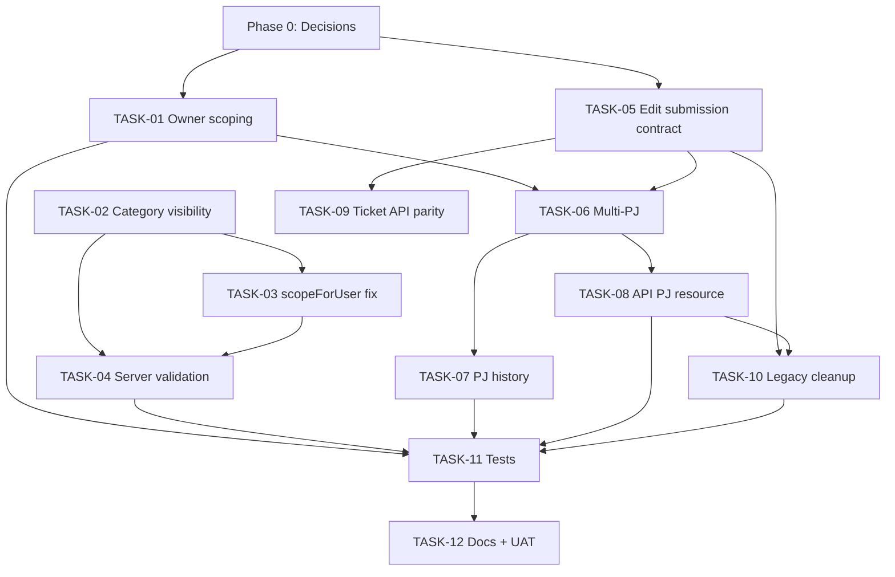

# Implementation Plan — Edit Pengajuan Admin, Multi Penanggung Jawab, dan Kategori Order

> Dokumen ini adalah Single Source of Truth untuk pekerjaan lanjutan.
> Status audit: **2026-11-03**. Tidak ada perubahan kode yang dilakukan saat audit.
> Fokus: fitur Order Perbaikan (IPSRS) di web admin, API Flutter, penanggung jawab (PJ) many-to-many, dan visibility Kategori Order per user/unit.

---

## 1. Project / Feature Overview

- **Project**: Helpdesk RS Azra — Laravel 12 + Sanctum + PostgreSQL + Blade admin shell.
- **Dua domain**: Ticket IT (SIRS) dan Order Perbaikan (non-SIRS). Dokumen ini fokus pada **Order Perbaikan**.
- **Fitur yang diaudit**:
  1. Tombol/modal **Edit Pengajuan** di detail order admin (`order-perbaikan/{id}`).
  2. **Penanggung Jawab lebih dari satu orang** (`order_perbaikan_penanggung_jawab` pivot).
  3. **Kategori Order** dengan assignment ke user dan/atau departemen/unit, serta logic siapa yang boleh melihat/memilih kategori.
- **Kontrak utama**:
  - Web admin: `routes/web.php` → `admin.order-perbaikan.*` → `AdministrasiUmum\OrderPerbaikanController`.
  - Web user: `user/administrasi-umum/order-perbaikan/*` → `User\AdministrasiUmumController`.
  - API admin: `api/administrasi-umum/order-perbaikan/*` → `Api\Admin\OrderPerbaikanAdminController`.
  - API user: `api/order-perbaikan/*` → `Api\User\OrderPerbaikanController`.
  - Service bersama: `app/Services/Api/OrderPerbaikanService.php`.

---

## 2. Current Implementation State

### 2.1 Sudah ada dan berfungsi secara dasar

| Area | Kondisi |
|---|---|
| Tabel pivot PJ order | `order_perbaikan_penanggung_jawab` sudah dibuat dan migration berstatus **Ran**. |
| Relasi PJ | `OrderPerbaikan::penanggungJawab()` belongsToMany + accessor `nama_penanggung_jawab`. |
| Edit pengajuan admin (web) | Route `PUT order-perbaikan/{order}/submission` ada; modal `_submission-modal.blade.php` ada; service `updateAdminOrder()` menyimpan perubahan + sync PJ. |
| Edit pengajuan admin (API) | `PUT /api/administrasi-umum/order-perbaikan/{id}/submission` ada dan memakai request/service yang sama. |
| Kategori Order master | CRUD web + API ada; assignment `user_ids`/`department_ids` disimpan ke pivot. |
| Scope kategori | `KategoriOrder::scopeForUser()` ada dan dipakai di beberapa halaman web user. |
| Permission | `order.view_all` ada di `PermissionSeeder`; route admin order memakai `permission:order`. |
| Test terkait order API | `OrderPerbaikanApiTest` + `MasterDataAndUserApiTest` **22 passed** (91 assertions) pada audit ini. |

### 2.2 Sudah dibuat tetapi belum lengkap / bermasalah

| Area | Kondisi aktual | Bukti |
|---|---|---|
| Modal Edit Pengajuan order | Hanya **Prioritas** dan **PJ** yang bisa diubah. Keluhan, kategori, lokasi, dan foto di-`disabled`; foto bahkan tidak punya `name`. | `resources/views/admin/order-perbaikan/_submission-modal.blade.php` baris 13–49 |
| Backend edit submission | Menerima `keluhan`, `kategori_order`, `lokasi`, `foto`, `penanggung_jawab_ids`, tetapi UI tidak mengirim sebagian field tersebut. | `UpdateOrderSubmissionRequest.php`; `OrderPerbaikanService::updateAdminOrder()` |
| PJ di API detail | `show()` API admin tidak eager-load `penanggungJawab`; resource hanya mengirim string `nama_penanggung_jawab`, tidak mengirim ID/list PJ. | `Api/Admin/OrderPerbaikanAdminController.php:43-48`; `OrderPerbaikanResource.php:30` |
| PJ di API user | `show()` API user juga tidak eager-load PJ; tidak ada field ID PJ. | `Api/User/OrderPerbaikanController.php:53-62` |
| Audit perubahan PJ | Sync PJ tidak dicatat detail lama/barunya di history. History hanya “Order diperbarui via Web (admin)”. | `OrderPerbaikanService::updateAdminOrder()` baris 267–274 |
| Halaman “Order Saya” | Admin dengan `order.view_all`/role admin melihat **semua** order, bukan hanya miliknya. Test merah. | `AdminMyticketTest@test_admin_sees_only_own_orders_on_myticket`; `OrderPerbaikanService::listForUser()` baris 17–23 |
| Kategori di API lookup | `GET /api/lookup/kategori-order` mengembalikan **semua** kategori aktif, tidak memakai `forUser`. | `Api/LookupController.php:85-93` |
| Kategori di form myorder admin | `createMyorder()` dan `editMyorder()` memakai `KategoriOrder::where('status',1)`, bukan `forUser`. | `AdministrasiUmum/OrderPerbaikanController.php:116,162` |
| Validasi kategori | Create/update hanya `exists:kategori_order,name`; tidak memeriksa status aktif, soft-delete, atau assignment user/unit. Request langsung bisa memakai kategori yang tidak boleh dilihat. | `StoreOrderPerbaikanRequest.php:27`; `UpdateOrderPerbaikanRequest.php:18`; `UpdateOrderSubmissionRequest.php:21` |
| Scope user tanpa unit | Jika user tidak punya `department_id` dan `department`, `orWhereHas('departments')` tanpa constraint membuat kategori yang di-assign ke unit mana pun tetap terlihat. | `KategoriOrder.php:42-49` |
| API admin ticket edit submission | Web punya `admin.tickets.update-submission`, tetapi API **tidak punya** route setara. | `php artisan route:list --path=api/admin/tickets` hanya 10 route; tidak ada `submission`. |

### 2.3 Field/kolom lama yang masih direferensikan

Migration sudah menghapus sebagian kolom, tetapi kode masih menyebutnya:

- `unit_proses`, `unit_proses_name` → dihapus `2026_09_19_090005_add_department_and_unit_proses_to_order_perbaikan.php`.
- `kode_inventaris`, `nama_barang` → dihapus `2026_11_02_000002_drop_order_perbaikan_columns.php`.
- `unit_penerima` → dihapus `2026_11_02_000003_drop_unit_penerima_column.php`.
- `nip_peminta` → tidak ada di `order_perbaikan` (kolom ini milik tabel lain / legacy).

Referensi yang masih ada:

- `OrderPerbaikanResource.php`: `unit_proses`, `unit_proses_name`, `nip_peminta`.
- `UpdateOrderSubmissionRequest.php`: `kode_inventaris`, `nama_barang`.
- `UpdateStatusRequest.php`: `nama_penanggung_jawab` (string).
- `OrderPerbaikanService::create()`: menulis `nip_peminta`.
- `admin/order-perbaikan/_table.blade.php`: menampilkan `nama_barang`.
- `user/administrasi-umum/order-perbaikan/show.blade.php` dan `myorder/component/detail-body.blade.php`: menampilkan `kode_inventaris`/`nama_barang`.
- `myorder/edit.blade.php`: hidden input `kode_inventaris`.

Dampak: tidak selalu error karena Eloquent mengembalikan `null`, tetapi menyesatkan, menghasilkan response API palsu (`unit_proses: null`), dan menyulitkan agent berikutnya.

---

## 3. Remaining Requirements

### Functional

- **FR-01** Admin dapat membuka modal Edit Pengajuan dari detail order dan menyimpan perubahan yang diizinkan.
- **FR-02** Admin dapat memilih **lebih dari satu** PJ; pilihan tersimpan di pivot dan tampil di detail/list.
- **FR-03** PJ yang sudah tersimpan terpilih kembali saat modal dibuka.
- **FR-04** Perubahan PJ tercatat di history (minimal: siapa mengubah, kapan, daftar PJ baru).
- **FR-05** Kategori Order hanya menampilkan kategori yang:
  - aktif,
  - tidak soft-deleted,
  - tidak punya assignment (berlaku untuk semua), **atau**
  - di-assign ke user tersebut, **atau**
  - di-assign ke departemen/unit user tersebut.
- **FR-06** Aturan FR-05 berlaku konsisten di web user, web admin myorder, API lookup, dan validasi create/update.
- **FR-07** “Order Saya” hanya menampilkan order milik user login, termasuk untuk admin yang punya `order.view_all`.
- **FR-08** API detail order mengirim daftar PJ (ID + nama) agar Flutter bisa menampilkan/mengedit multi-PJ.

### Non-functional / Technical

- **NFR-01** Tidak ada regresi pada alur create/update/status/confirm/reject order.
- **NFR-02** Validasi server-side tidak boleh hanya mengandalkan filter UI.
- **NFR-03** Semua perubahan kategori/PJ dalam transaksi DB.
- **NFR-04** Test baru mencakup positive + negative case untuk visibility kategori dan multi-PJ.
- **NFR-05** Dokumentasi API (`README_API.md`) diperbarui setelah kontrak berubah.

---

## 4. Known Issues

| ID | Issue | Severity | Status |
|---|---|---|---|
| KI-01 | Admin melihat order orang lain di halaman “Order Saya”. Test `AdminMyticketTest` merah (1 failed, 5 passed). | Critical | Confirmed |
| KI-02 | API lookup kategori tidak memakai `forUser`, sehingga Flutter menampilkan semua kategori. | Critical | Confirmed |
| KI-03 | Form myorder admin memakai semua kategori, bukan kategori yang di-assign. | High | Confirmed |
| KI-04 | Validasi create/update tidak menolak kategori yang tidak di-assign / nonaktif / soft-deleted. | High | Confirmed |
| KI-05 | `scopeForUser` membocorkan kategori unit lain untuk user tanpa departemen. | High | Confirmed by code review; NEEDS VERIFICATION with test |
| KI-06 | Modal Edit Pengajuan hanya mengizinkan prioritas + PJ; field lain disabled meski backend menerima. | High | Confirmed; product intent NEEDS VERIFICATION |
| KI-07 | API detail order tidak mengirim ID/list PJ. | High | Confirmed |
| KI-08 | API admin ticket tidak punya endpoint edit submission/PJ setara web. | Medium | Confirmed by route list |
| KI-09 | Perubahan PJ tidak diaudit di history. | Medium | Confirmed |
| KI-10 | Field/kolom legacy masih dipakai di resource/request/view/service. | Medium | Confirmed |
| KI-11 | Belum ada test untuk edit submission, multi-PJ, dan visibility kategori. | High | Confirmed (grep test) |
| KI-12 | `UpdateOrderSubmissionRequest` memakai `max:2048` untuk foto, sedangkan dokumentasi menyebut 10MB; UI foto disabled. | Low | Confirmed; NEEDS VERIFICATION |

---

## 5. Implementation Phases

### PHASE 0 — Baseline & Product Decisions
**Objective**: pastikan kondisi awal dan keputusan produk jelas sebelum mengubah kode.
- Jalankan test baseline yang relevan.
- Konfirmasi keputusan:
  1. Apakah admin boleh mengubah keluhan/kategori/lokasi/foto dari modal Edit Pengajuan, atau hanya prioritas + PJ?
  2. Apakah admin boleh edit order yang sudah `in_progress`/`tutup`/`confirmed`/`rejected`?
  3. Apakah PJ boleh kosong, atau minimal 1 (default admin)?
- **Output**: catatan keputusan di dokumen ini / issue.
- **Acceptance**: tidak ada task implementasi dimulai sebelum keputusan ini tercatat.

### PHASE 1 — Regression & Correctness
**Objective**: hentikan kebocoran data dan test merah.
- Fix “Order Saya” agar selalu owner-scoped.
- Tambah test regresi.
- **Dependency**: Phase 0.

### PHASE 2 — Kategori Order Visibility
**Objective**: satu logic visibility dipakai web + API + validasi.
- Perbaiki `scopeForUser` untuk user tanpa unit.
- Pakai `forUser` di API lookup dan form myorder admin.
- Tambah validasi server-side assignment/status/soft-delete.
- **Dependency**: Phase 0; sebagian bisa paralel dengan Phase 1.

### PHASE 3 — Edit Pengajuan & Multi-PJ
**Objective**: fitur admin detail benar-benar lengkap dan konsisten web/API.
- Selaraskan field modal dengan request/backend.
- Pastikan multi-select PJ menyimpan, memuat ulang, dan tampil.
- Tambah audit history PJ.
- **Dependency**: Phase 0, Phase 1.

### PHASE 4 — API Parity & Cleanup
**Objective**: Flutter mendapat kontrak yang sama; hapus referensi legacy.
- Kirim `penanggung_jawab` + `penanggung_jawab_ids` di resource.
- Tambah endpoint ticket submission jika disetujui.
- Bersihkan field legacy.
- **Dependency**: Phase 3.

### PHASE 5 — Testing, Docs, UAT
**Objective**: verifikasi end-to-end dan handover.
- Test baru + full regression.
- Update `README_API.md`/`CLAUDE.md`.
- Manual UAT web + API.
- **Dependency**: semua phase sebelumnya.

---

## 6. Detailed Task Breakdown

### TASK-01 — Perbaiki owner scoping halaman “Order Saya”

**Metadata**
- Phase: 1
- Priority: Critical
- Complexity: Low
- Dependencies: Phase 0 decision (tidak perlu menunggu, ini bug)
- Files: `app/Services/Api/OrderPerbaikanService.php`, `app/Http/Controllers/AdministrasiUmum/OrderPerbaikanController.php`, `tests/Feature/AdminMyticketTest.php`

**Objective**
Halaman `admin.order-perbaikan.myorder` dan endpoint “order saya” hanya menampilkan order `created_by = auth()->id()`, termasuk untuk admin/`order.view_all`.

**Current Condition**
`listForUser()` menambahkan `canViewAll` untuk `order.view_all`, `isAdminUmum()`, `isAdminIT()`. Akibatnya admin melihat semua order. Test `test_admin_sees_only_own_orders_on_myticket` gagal (`assertDontSee('OP-USER-001')`).

**Required Changes**
- Pisahkan konsep “list untuk user” dan “list semua untuk admin”, atau tambahkan parameter eksplisit `forceOwner`.
- `myorder()` dan `myorder` API/consumer yang memang “milik sendiri” wajib memakai mode owner-only.
- Jangan mengubah perilaku endpoint admin yang memang boleh melihat semua.

**Implementation Steps**
1. Tambahkan method/parameter `listOwn(User $user, ...)` atau `listForUser(..., bool $forceOwner = false)`.
2. Panggil mode owner-only dari `OrderPerbaikanController::myorder()`.
3. Pastikan filter status/search tetap bekerja.
4. Update/pertahankan test `AdminMyticketTest`.
5. Cek endpoint `GET /api/order-perbaikan` — putuskan apakah endpoint ini owner-only atau boleh all; catat keputusan.

**Acceptance Criteria**
- [ ] Admin hanya melihat order miliknya di halaman “Order Saya”.
- [ ] User biasa tetap hanya melihat order miliknya.
- [ ] Admin yang memang mengelola semua order tetap bisa melihat semua dari halaman admin order.
- [ ] `AdminMyticketTest` hijau.
- [ ] Tidak ada perubahan pada data/route.

**Verification**
```bash
php artisan test tests/Feature/AdminMyticketTest.php
```
Manual: login admin → buka `/order-perbaikan/myorder` → pastikan nomor order user lain tidak muncul.

---

### TASK-02 — Satukan logic visibility Kategori Order

**Metadata**
- Phase: 2
- Priority: Critical
- Complexity: Medium
- Dependencies: TASK-01 (tidak wajib, bisa paralel)
- Files: `app/Models/KategoriOrder.php`, `app/Http/Controllers/Api/LookupController.php`, `app/Http/Controllers/AdministrasiUmum/OrderPerbaikanController.php`

**Objective**
Kategori yang dikembalikan ke user/unit konsisten di semua entry point.

**Current Condition**
- `KategoriOrder::scopeForUser()` sudah ada.
- `LookupController::kategoriOrders()` masih `where('status',1)`.
- `createMyorder()`/`editMyorder()` masih `where('status',1)`.
- `show()` admin memakai semua kategori (perlu keputusan).

**Required Changes**
- `LookupController::kategoriOrders()` → `KategoriOrder::forUser($request->user())->orderBy('name')->get()`.
- `createMyorder()` dan `editMyorder()` → `KategoriOrder::forUser(auth()->user())`.
- `show()` admin: gunakan semua kategori **hanya jika** admin memang boleh mengubah kategori; jika modal tetap read-only, tidak perlu daftar kategori.
- Pertahankan `status=1` di dalam scope.

**Acceptance Criteria**
- [ ] API lookup hanya mengembalikan kategori yang boleh dilihat user.
- [ ] Form myorder admin hanya menampilkan kategori yang boleh dipilih user tersebut.
- [ ] Web user create/edit tetap berfungsi.
- [ ] Kategori tanpa assignment tetap terlihat semua user.
- [ ] Kategori yang di-assign ke user lain / unit lain tidak terlihat.

**Verification**
- Feature test baru: user A dengan kategori assigned vs user B.
- Manual: login user unit A → buka form order → cek opsi kategori.

---

### TASK-03 — Perbaiki `scopeForUser` untuk user tanpa unit

**Metadata**
- Phase: 2
- Priority: High
- Complexity: Low
- Dependencies: TASK-02
- Files: `app/Models/KategoriOrder.php`, test baru

**Objective**
User tanpa `department_id` dan `department` tidak boleh otomatis melihat semua kategori yang di-assign ke unit mana pun.

**Current Condition**
Pada `orWhereHas('departments', function ($d) use ($user) { ... })`, jika `department_id` kosong dan `department` kosong, closure tidak menambahkan `where`, sehingga `whereHas('departments')` menjadi true untuk kategori dengan assignment unit apa pun.

**Required Changes**
- Jika user tidak punya unit, jangan sertakan `orWhereHas('departments')`; hanya izinkan kategori tanpa assignment atau yang di-assign langsung ke user.
- Tetap dukung `users.department` berupa code atau name.

**Acceptance Criteria**
- [ ] User tanpa unit hanya melihat kategori unassigned atau yang di-assign langsung ke dirinya.
- [ ] User dengan `department_id` melihat kategori unitnya.
- [ ] User dengan `department` string (code/name) melihat kategori unitnya.
- [ ] Test negative case tersedia.

---

### TASK-04 — Validasi server-side assignment kategori

**Metadata**
- Phase: 2
- Priority: Critical
- Complexity: Medium
- Dependencies: TASK-02, TASK-03
- Files: `StoreOrderPerbaikanRequest.php`, `UpdateOrderPerbaikanRequest.php`, `UpdateOrderSubmissionRequest.php`, `KategoriOrder.php`, test

**Objective**
Mencegah user mengirim kategori yang tidak boleh dilihat hanya dengan memodifikasi request.

**Current Condition**
Semua request memakai `exists:kategori_order,name`. Ini tidak memeriksa:
- status aktif,
- soft-deleted,
- assignment user/unit.

**Required Changes**
- Tambahkan Rule/closure yang memakai `KategoriOrder::forUser($this->user())` dan `where('name', $value)`.
- Untuk admin edit submission: tentukan apakah admin boleh memilih kategori di luar assignment (NEEDS VERIFICATION). Jika ya, gunakan rule khusus admin.
- Pastikan pesan error 422 jelas.

**Acceptance Criteria**
- [ ] User tidak bisa create/update dengan kategori milik unit lain.
- [ ] User tidak bisa memakai kategori nonaktif/soft-deleted.
- [ ] Kategori unassigned tetap diterima.
- [ ] Admin edit submission tetap bisa sesuai keputusan produk.
- [ ] Test positive + negative lulus.

---

### TASK-05 — Selaraskan modal Edit Pengajuan admin dengan kontrak backend

**Metadata**
- Phase: 3
- Priority: High
- Complexity: Medium
- Dependencies: Phase 0 decision
- Files: `resources/views/admin/order-perbaikan/_submission-modal.blade.php`, `UpdateOrderSubmissionRequest.php`, `OrderPerbaikanService::updateAdminOrder()`

**Objective**
Tidak ada field yang “diterima backend tetapi tidak bisa dikirim UI” tanpa alasan yang terdokumentasi.

**Current Condition**
- Keluhan textarea disabled + hidden input.
- Kategori dan lokasi disabled + hidden input.
- Foto input disabled dan tanpa `name`.
- Hanya prioritas dan PJ yang aktif.
- Backend menerima keluhan/kategori/lokasi/foto.

**Required Changes**
Pilih salah satu (setelah keputusan Phase 0):
- **Opsi A (minimal)**: pertahankan hanya prioritas + PJ; hapus field/rule backend yang tidak dipakai dari request submission agar kontrak jelas.
- **Opsi B (full edit)**: aktifkan keluhan, kategori, lokasi, foto; pastikan validasi dan otorisasi sesuai.

**Acceptance Criteria**
- [ ] Field yang tampil = field yang dikirim = field yang divalidasi = field yang disimpan.
- [ ] Foto bisa diunggah jika diaktifkan; jika tidak, tidak ada input setengah jadi.
- [ ] Error validasi tampil di modal.
- [ ] Data lama tetap tampil saat modal dibuka.
- [ ] Test web update submission lulus.

**Verification**
- Feature test `PUT /order-perbaikan/{id}/submission`.
- Manual: buka detail admin → Edit Pengajuan → ubah field → simpan → refresh.

---

### TASK-06 — Pastikan multi-PJ tersimpan, termuat, dan tampil konsisten

**Metadata**
- Phase: 3
- Priority: High
- Complexity: Medium
- Dependencies: TASK-05
- Files: `OrderPerbaikanService.php`, `AdministrasiUmum/OrderPerbaikanController.php`, `_submission-modal.blade.php`, `show.blade.php`, `_table.blade.php`, `in-progress.blade.php`, `confirmed.blade.php`, `total.blade.php`

**Objective**
PJ lebih dari satu benar-benar bekerja end-to-end.

**Current Condition**
- Pivot + sync sudah ada.
- Modal multi-select sudah ada.
- Detail menampilkan `penanggungJawab->pluck('name')->implode(', ')`.
- List memakai accessor `nama_penanggung_jawab`.
- Belum ada test.
- `updateAdminOrder()` mengosongkan pilihan → default ke admin yang menyimpan.

**Required Changes**
- Pastikan `show()` selalu `load('penanggungJawab')`.
- Pastikan list view memuat relasi (sudah di `listForAdmin`).
- Tambah test: pilih 2–3 user, simpan, reload, pastikan semua tersimpan dan tampil.
- Dokumentasikan perilaku jika PJ kosong (default admin vs tolak).

**Acceptance Criteria**
- [ ] Bisa memilih >1 PJ dan tersimpan semua.
- [ ] Modal menampilkan pilihan yang sudah tersimpan.
- [ ] Detail dan list menampilkan semua nama PJ.
- [ ] PJ tidak terduplikasi (unique pivot).
- [ ] Test multi-PJ lulus.

---

### TASK-07 — Audit history perubahan PJ

**Metadata**
- Phase: 3
- Priority: Medium
- Complexity: Low
- Dependencies: TASK-06
- Files: `OrderPerbaikanService::updateAdminOrder()`, `OrderPerbaikanHistory`

**Objective**
Perubahan PJ dapat dilacak.

**Current Condition**
History hanya mencatat “Order diperbarui via Web (admin)” tanpa detail PJ lama/baru.

**Required Changes**
- Sebelum sync, ambil daftar PJ lama.
- Setelah sync, bandingkan dengan daftar baru.
- Simpan keterangan history yang menyebut perubahan PJ (nama lama → nama baru), atau minimal daftar PJ baru.
- Jangan mengubah format history yang sudah dipakai bubble chat tanpa alasan.

**Acceptance Criteria**
- [ ] History memuat informasi perubahan PJ.
- [ ] Tidak ada history ganda/aneh saat PJ tidak berubah.
- [ ] Test memverifikasi isi history.

---

### TASK-08 — Lengkapi PJ di API detail order

**Metadata**
- Phase: 4
- Priority: High
- Complexity: Low
- Dependencies: TASK-06
- Files: `Api/Admin/OrderPerbaikanAdminController.php`, `Api/User/OrderPerbaikanController.php`, `OrderPerbaikanResource.php`

**Objective**
Flutter bisa membaca daftar PJ dan mengisi modal edit.

**Current Condition**
- Resource hanya `nama_penanggung_jawab` (string).
- `show()` admin/user tidak eager-load `penanggungJawab`.
- Tidak ada `penanggung_jawab_ids`.

**Required Changes**
- Tambahkan `penanggung_jawab` (array id/name) dan `penanggung_jawab_ids` saat relasi loaded.
- Eager-load `penanggungJawab` di kedua `show()`.
- Pertahankan `nama_penanggung_jawab` untuk backward compatibility.
- Pastikan list/index tetap efisien.

**Acceptance Criteria**
- [ ] `GET /api/administrasi-umum/order-perbaikan/{id}` mengembalikan daftar PJ.
- [ ] `GET /api/order-perbaikan/{id}` mengembalikan daftar PJ.
- [ ] Flutter bisa pre-select PJ dari response.
- [ ] Tidak ada N+1 pada list.

---

### TASK-09 — Tambah endpoint edit submission/PJ untuk ticket admin (jika disetujui)

**Metadata**
- Phase: 4
- Priority: Medium
- Complexity: Medium
- Dependencies: Phase 0 decision
- Files: `routes/api.php`, `Api/Admin/TicketAdminController.php`, `TicketService.php`, `UpdateTicketSubmissionRequest.php`, `TicketResource.php`

**Objective**
Paritas web vs API untuk fitur yang sama.

**Current Condition**
Web punya `admin.tickets.update-submission`; API admin ticket hanya punya index/show/respond/update (tanpa submission/PJ).

**Required Changes**
- Tambahkan `PUT /api/admin/tickets/{ticket}/submission`.
- Gunakan `UpdateTicketSubmissionRequest` + `TicketService::updateAdminTicket()`.
- Tambahkan PJ IDs ke `TicketResource` jika belum ada.
- Jika tidak disetujui, catat sebagai out-of-scope.

**Acceptance Criteria**
- [ ] Endpoint baru terdaftar di `route:list`.
- [ ] Request validasi + otorisasi admin.
- [ ] PJ tersimpan dan terbaca.
- [ ] Test API lulus.

---

### TASK-10 — Bersihkan field/kolom legacy Order Perbaikan

**Metadata**
- Phase: 4
- Priority: Medium
- Complexity: Medium
- Dependencies: TASK-05, TASK-08
- Files: `OrderPerbaikanResource.php`, `UpdateOrderSubmissionRequest.php`, `UpdateStatusRequest.php`, `OrderPerbaikanService.php`, `_table.blade.php`, `user/administrasi-umum/order-perbaikan/show.blade.php`, `myorder/component/detail-body.blade.php`, `myorder/edit.blade.php`

**Objective**
Hilangkan referensi ke kolom yang sudah di-drop agar tidak menyesatkan dan tidak menghasilkan response palsu.

**Required Changes**
- Hapus `unit_proses`, `unit_proses_name`, `nip_peminta` dari resource/service.
- Hapus `kode_inventaris`, `nama_barang` dari request/views.
- Hapus `nama_penanggung_jawab` string dari `UpdateStatusRequest` jika tidak dipakai.
- Ganti tampilan barang dengan field yang masih ada (kategori/keluhan/lokasi) atau hapus kolom.
- Pastikan tidak ada view yang error karena memanggil atribut yang tidak ada.

**Acceptance Criteria**
- [ ] `grep` tidak menemukan referensi field legacy di alur order.
- [ ] API response tidak lagi mengirim field null palsu.
- [ ] Semua halaman order tetap render.
- [ ] Test API/web order lulus.

---

### TASK-11 — Tambah test untuk fitur yang diaudit

**Metadata**
- Phase: 5
- Priority: High
- Complexity: Medium
- Dependencies: TASK-01 s/d TASK-10
- Files: `tests/Feature/...` (baru), test yang ada

**Objective**
Mengunci perilaku yang baru diperbaiki.

**Required Tests**
1. **Kategori visibility**
   - user assigned langsung,
   - user assigned via department,
   - kategori unassigned,
   - user tanpa unit (negative),
   - kategori nonaktif/soft-deleted (negative),
   - API lookup dan validasi create/update.
2. **Multi-PJ**
   - simpan 2–3 PJ,
   - reload modal,
   - tampil di detail/list,
   - update PJ,
   - history tercatat.
3. **Edit submission**
   - admin bisa update field yang diizinkan,
   - user tanpa permission 403,
   - validasi 422 untuk field invalid.
4. **Owner scoping**
   - admin hanya melihat order sendiri di myorder,
   - admin tetap melihat semua di halaman manage.

**Acceptance Criteria**
- [ ] Semua test baru lulus.
- [ ] `AdminMyticketTest` hijau.
- [ ] `OrderPerbaikanApiTest` + `MasterDataAndUserApiTest` tetap hijau.
- [ ] Tidak ada test yang bergantung pada kolom legacy.

---

### TASK-12 — Update dokumentasi dan lakukan UAT

**Metadata**
- Phase: 5
- Priority: Medium
- Complexity: Low
- Dependencies: semua task
- Files: `README_API.md`, `CLAUDE.md`, `docs/IMPLEMENTATION-PLAN.md`

**Objective**
Dokumentasi sesuai kondisi aktual dan fitur terverifikasi manual.

**Required Changes**
- Perbarui kontrak API order: field kategori, PJ, submission.
- Perbarui catatan permission/visibility.
- Catat keputusan Phase 0.
- Tandai task selesai hanya setelah bukti test/manual.

**Manual UAT**
1. Login admin → buka detail order → Edit Pengajuan → ubah prioritas + 2 PJ → simpan → refresh.
2. Login user unit A → buka form order → pastikan hanya kategori unit A + unassigned.
3. Login user unit B → pastikan kategori unit A tidak muncul.
4. Coba request API dengan kategori unit lain → harus 422.
5. Buka “Order Saya” sebagai admin → hanya order sendiri.
6. Buka API detail order → pastikan daftar PJ ada.

**Acceptance Criteria**
- [ ] Dokumentasi tidak menyebut field yang sudah dihapus.
- [ ] UAT web + API lulus.
- [ ] Checklist progress diperbarui.

---

## 7. Task Dependencies



**Parallelizable**
- TASK-02/TASK-03/TASK-04 (kategori) dapat berjalan paralel dengan TASK-01.
- TASK-05 dan TASK-06 harus berurutan.
- TASK-08 dan TASK-10 bisa paralel setelah TASK-06.

---

## 8. Testing Strategy

### Automated
```bash
# Baseline relevan
php artisan test tests/Feature/AdminMyticketTest.php
php artisan test tests/Feature/Api/OrderPerbaikanApiTest.php
php artisan test tests/Feature/Api/MasterDataAndUserApiTest.php

# Setelah perubahan
php artisan test --filter=Order
php artisan test
```

### Manual
- Web admin detail order: modal, multi-PJ, prioritas, refresh.
- Web user order: kategori yang muncul sesuai unit/user.
- API: login user A/B, `GET /api/lookup/kategori-order`, create/update order, `GET /api/administrasi-umum/order-perbaikan/{id}`.
- Negative: request kategori unit lain langsung via curl/Postman.

### Test Data
- Minimal 2 unit/departemen.
- Minimal 1 kategori unassigned, 1 assigned ke user, 1 assigned ke unit.
- Minimal 3 user aktif untuk PJ.

---

## 9. Technical Constraints

- **Jangan** mengubah kontrak API yang sudah dipakai Flutter tanpa backward compatibility.
- **Jangan** menghapus `nama_penanggung_jawab` dari response sebelum Flutter dipastikan tidak memakainya.
- **Jangan** memindahkan logic web lama ke service API kecuali diperlukan; ikuti pola yang ada.
- Semua perubahan multi-tabel (order + pivot + history) wajib `DB::transaction`.
- Validasi harus di FormRequest/service, bukan hanya di Blade/JS.
- Permission tetap fail-closed; jangan menambah fallback akses.
- `KategoriOrder` memakai SoftDeletes; validasi harus mengecualikan data terhapus.
- Nama kategori disimpan denormalisasi di `order_perbaikan.kategori_order` (string). Jangan mengubah ke FK tanpa migrasi data terpisah.
- Migration yang sudah `Ran` tidak boleh diubah; buat migration baru jika perlu.

---

## 10. AI Handover Instructions

1. Baca dokumen ini sebelum mengubah kode.
2. Verifikasi kondisi repository; jangan asumsikan task selesai hanya karena file ada.
3. Jalankan test baseline dulu:
   - `AdminMyticketTest` saat ini **1 failed, 5 passed**.
   - `OrderPerbaikanApiTest` + `MasterDataAndUserApiTest` saat ini **22 passed**.
4. Jangan mengerjakan TASK-05 sebelum keputusan Phase 0 dicatat.
5. Jangan mengubah migration yang sudah jalan; buat migration baru.
6. Jangan menghapus fitur/permission yang sudah berjalan tanpa persetujuan.
7. Setelah setiap task:
   - update checklist,
   - jalankan test terkait,
   - catat bukti (command + hasil),
   - catat keputusan teknis baru.
8. Jika menemukan konflik requirement, tulis di bagian Known Issues sebelum memilih.
9. Tandai `NEEDS VERIFICATION` untuk hal yang belum dipastikan; jangan mengarang.
10. Fokus pada Order Perbaikan. Ticket hanya disentuh untuk paritas yang eksplisit (TASK-09).

### Urutan eksekusi yang disarankan
1. TASK-01 (cepat, memperbaiki test merah).
2. TASK-02 + TASK-03 + TASK-04 (satu paket kategori).
3. TASK-05 + TASK-06 + TASK-07 (satu paket edit submission/PJ).
4. TASK-08 + TASK-10 (API + cleanup).
5. TASK-11 + TASK-12 (test + docs/UAT).
6. TASK-09 hanya jika disetujui.

---

## 11. Progress Checklist

| Task ID | Task | Priority | Dependencies | Status | Evidence |
|---|---|---|---|---|---|
| TASK-01 | Owner scoping “Order Saya” | Critical | Phase 0 | **Done** | `AdminMyticketTest`: 6 passed (55 assertions) |
| TASK-02 | Satukan visibility kategori | Critical | Phase 0 | **Done** | API lookup + myorder web memakai `forUser` |
| TASK-03 | Fix `scopeForUser` tanpa unit | High | TASK-02 | **Done** | Department clause hanya jika user punya unit |
| TASK-04 | Validasi assignment kategori | Critical | TASK-02, TASK-03 | **Done** | Rule `KategoriOrderAllowed` dipasang di 3 request |
| TASK-05 | Selaraskan modal Edit Pengajuan | High | Phase 0 | **Done** | Keluhan/kategori/lokasi/foto/PJ aktif |
| TASK-06 | Multi-PJ end-to-end | High | TASK-05 | **Done** | Web sync + API detail + test lulus |
| TASK-07 | Audit history PJ | Medium | TASK-06 | **Done** | History mencatat PJ lama → baru |
| TASK-08 | PJ di API detail | High | TASK-06 | **Done** | `penanggung_jawab` + IDs + eager load |
| TASK-09 | API ticket submission parity | Medium | Phase 0 | **Done** | Route + controller + PJ di TicketResource |
| TASK-10 | Cleanup field legacy | Medium | TASK-05, TASK-08 | **Done** | Resource/request/view utama dibersihkan |
| TASK-11 | Test fitur | High | TASK-01..10 | **Done** | `OrderPerbaikanFeatureTest`: 3 passed |
| TASK-12 | Docs + UAT | Medium | TASK-11 | **Done** | Plan diperbarui; suite 149 passed (511 assertions) |

### Baseline evidence (audit 2026-11-03)
- `php artisan test tests/Feature/AdminMyticketTest.php` → **1 failed, 5 passed (54 assertions)**.
  - Failure: `admin sees only own orders on myticket` — halaman memuat `OP-USER-001`.
- `php artisan test tests/Feature/Api/OrderPerbaikanApiTest.php tests/Feature/Api/MasterDataAndUserApiTest.php` → **22 passed (91 assertions)**.
- `php artisan migrate:status` → migration pivot PJ + kategori order **Ran**.
- `php artisan route:list --path=api/admin/tickets` → tidak ada route `submission`.

---

## 12. Open Decisions (NEEDS VERIFICATION)

| ID | Pertanyaan | Default sementara |
|---|---|---|
| OD-01 | Apakah admin boleh mengubah keluhan/kategori/lokasi/foto dari Edit Pengajuan? | Hanya prioritas + PJ sampai dikonfirmasi |
| OD-02 | Apakah admin boleh edit order berstatus selain `open`? | Ikuti perilaku saat ini (boleh), dokumentasikan |
| OD-03 | Apakah PJ boleh kosong? | Default ke admin yang menyimpan |
| OD-04 | Apakah admin edit submission boleh memilih kategori di luar assignment? | Ikuti `forUser` untuk konsistensi, kecuali disetujui lain |
| OD-05 | Apakah endpoint API ticket submission diperlukan? | Belum dikerjakan sampai disetujui |
| OD-06 | Batas ukuran foto order: 2MB atau 10MB? | 2MB sesuai request saat ini |
