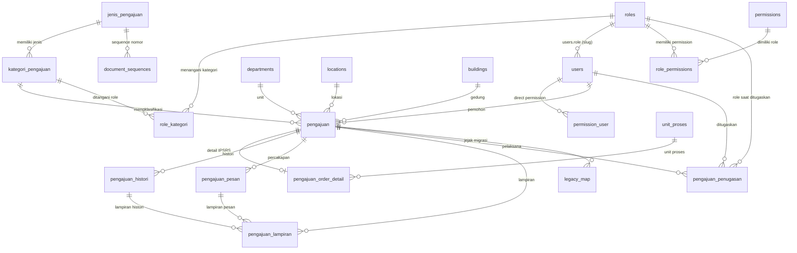

# 02 — Target Database Design

Status: **DRAFT — menunggu approval desain**
Baseline: production `d8de3e9`
Database acuan: `db_helpdesk.sql` (salinan production, PostgreSQL 17.6 dump)

---

## 1. Prinsip Desain

1. **Satu tabel transaksi utama:** `pengajuan`.
2. **Tidak ada** `tickets` dan `order_perbaikan` sebagai tabel transaksi baru. Keduanya menjadi sumber migrasi dan diarsipkan sebagai `*_legacy`.
3. **Satu tabel kategori:** `kategori_pengajuan`, dengan `jenis_id` yang menentukan domain.
4. **Satu role per user:** tetap memakai `users.role` → `roles.slug`. Tidak ada `role_user`.
5. **Role > permission:** permission hanya untuk menu/feature gate. Ruang lingkup data ditentukan `role_kategori`.
6. **Role-kategori adalah inti penugasan:** user yang memiliki role tersebut menjadi PJ untuk kategori itu, dan menerima notifikasi.
7. **Penugasan aktual per pengajuan** disimpan terpisah di `pengajuan_penugasan`.
8. **Satu status per pengajuan.** Tidak ada status keseluruhan vs status per track.
9. **Status mengikuti satu alur saat ini:** `open → in_progress → pending_confirmation → confirmed/rejected`.
10. **Nomor lama dipertahankan.** Nomor baru dibangkitkan berdasarkan jenis pengajuan/kategori.
11. **Order hanya untuk kategori non-IT.** Kategori dengan `jenis = IT` hanya membuat pengajuan IT.
12. **Tidak ada TV dual-domain** pada arsitektur baru.

---

## 2. ERD



---

## 3. Tabel Baru

### 3.1 `jenis_pengajuan`

Master jenis/domain. Menentukan prefix nomor dan perilaku form.

```sql
CREATE TABLE jenis_pengajuan (
    id              BIGSERIAL PRIMARY KEY,
    code            VARCHAR(20) NOT NULL UNIQUE,      -- IT, IPSRS
    name            VARCHAR(100) NOT NULL,
    prefix          VARCHAR(30) NOT NULL,             -- T, OP/RTG/MTC
    is_active       BOOLEAN NOT NULL DEFAULT TRUE,
    created_at      TIMESTAMP NULL,
    updated_at      TIMESTAMP NULL
);
```

Seed awal:

| code | name | prefix |
|---|---|---|
| `IT` | Tiket IT / SIRS | `T` |
| `IPSRS` | Order Perbaikan / IPSRS | `OP/RTG/MTC` |

### 3.2 `kategori_pengajuan`

Hasil merge `categories` (IT) dan `kategori_order` (IPSRS).

```sql
CREATE TABLE kategori_pengajuan (
    id              BIGSERIAL PRIMARY KEY,
    jenis_id        BIGINT NOT NULL REFERENCES jenis_pengajuan(id) ON DELETE RESTRICT,
    code            VARCHAR(50) NULL UNIQUE,
    name            VARCHAR(150) NOT NULL,
    description     TEXT NULL,
    status          SMALLINT NOT NULL DEFAULT 1,
    created_at      TIMESTAMP NULL,
    updated_at      TIMESTAMP NULL,
    deleted_at      TIMESTAMP NULL
);

CREATE UNIQUE INDEX kategori_pengajuan_jenis_name_unique
    ON kategori_pengajuan (jenis_id, LOWER(name))
    WHERE deleted_at IS NULL;

CREATE INDEX kategori_pengajuan_jenis_status_idx
    ON kategori_pengajuan (jenis_id, status);
```

Aturan:

- Nama unik per jenis, case-insensitive, hanya untuk baris aktif.
- `code` opsional; dipakai untuk kategori IPSRS yang sudah punya kode.
- Kategori tidak boleh dihapus keras jika sudah dipakai `pengajuan`; gunakan soft delete/nonaktifkan.
- Kategori IT dan IPSRS tidak boleh memiliki nama yang sama dalam satu jenis.

### 3.3 `pengajuan`

Header tunggal untuk semua pengajuan.

```sql
CREATE TABLE pengajuan (
    id                  BIGSERIAL PRIMARY KEY,
    nomor               VARCHAR(60) NOT NULL UNIQUE,
    kategori_id         BIGINT NOT NULL REFERENCES kategori_pengajuan(id) ON DELETE RESTRICT,
    pemohon_id          BIGINT NOT NULL REFERENCES users(id) ON DELETE RESTRICT,
    pemohon_nama        VARCHAR(255) NOT NULL,          -- snapshot
    department_id       BIGINT NULL REFERENCES departments(id) ON DELETE SET NULL,
    lokasi_id           BIGINT NULL REFERENCES locations(id) ON DELETE SET NULL,
    building_id         BIGINT NULL REFERENCES buildings(id) ON DELETE SET NULL,
    deskripsi           TEXT NOT NULL,
    prioritas           VARCHAR(20) NOT NULL DEFAULT 'medium'
                        CHECK (prioritas IN ('low','medium','high')),
    status              VARCHAR(30) NOT NULL DEFAULT 'open'
                        CHECK (status IN ('open','in_progress','pending_confirmation','confirmed','rejected')),
    follow_up           TEXT NULL,
    tanggal             TIMESTAMP NOT NULL DEFAULT NOW(),
    started_at          TIMESTAMP NULL,
    closed_at           TIMESTAMP NULL,
    confirmed_at        TIMESTAMP NULL,
    rejected_at         TIMESTAMP NULL,
    rejection_count     INTEGER NOT NULL DEFAULT 0,
    user_confirmation   BOOLEAN NOT NULL DEFAULT FALSE,
    user_confirmed_at   TIMESTAMP NULL,
    created_by          BIGINT NOT NULL REFERENCES users(id) ON DELETE RESTRICT,
    updated_by          BIGINT NULL REFERENCES users(id) ON DELETE SET NULL,
    legacy_source       VARCHAR(20) NULL CHECK (legacy_source IN ('ticket','order')),
    legacy_id           BIGINT NULL,
    created_at          TIMESTAMP NULL,
    updated_at          TIMESTAMP NULL,
    deleted_at          TIMESTAMP NULL
);

CREATE UNIQUE INDEX pengajuan_legacy_unique
    ON pengajuan (legacy_source, legacy_id)
    WHERE legacy_source IS NOT NULL;

CREATE INDEX pengajuan_kategori_status_idx ON pengajuan (kategori_id, status);
CREATE INDEX pengajuan_pemohon_created_idx ON pengajuan (pemohon_id, created_at);
CREATE INDEX pengajuan_status_created_idx ON pengajuan (status, created_at);
CREATE INDEX pengajuan_department_idx ON pengajuan (department_id);
CREATE INDEX pengajuan_created_at_idx ON pengajuan (created_at);
```

Catatan:

- `pemohon_nama` adalah snapshot agar histori tidak berubah saat nama user berubah.
- `department_id` nullable untuk kompatibilitas order lama; validasi aplikasi mewajibkan untuk IT.
- `nomor` menyimpan nomor lama apa adanya untuk data migrasi.
- `legacy_source`/`legacy_id` hanya untuk data lama; data baru `NULL`.
- Tidak ada `admin_confirmation*`; konfirmasi admin dicatat sebagai histori.
- `rejection_count`, `user_confirmation`, `user_confirmed_at` dipertahankan untuk perilaku konfirmasi saat ini.

### 3.4 `pengajuan_order_detail`

Atribut khusus IPSRS yang tidak dimiliki IT. Satu baris per pengajuan IPSRS.

```sql
CREATE TABLE pengajuan_order_detail (
    pengajuan_id     BIGINT PRIMARY KEY REFERENCES pengajuan(id) ON DELETE CASCADE,
    unit_penerima    VARCHAR(255) NULL,
    kode_inventaris  VARCHAR(255) NULL,
    nama_barang      VARCHAR(255) NULL,
    unit_proses_id   BIGINT NULL REFERENCES unit_proses(id) ON DELETE SET NULL,
    created_at       TIMESTAMP NULL,
    updated_at       TIMESTAMP NULL
);
```

Atribut IT tidak memerlukan tabel detail; atribut seperti `admin_notes`, `rejection_notes`, `confirmation_notes` dipindahkan ke `pengajuan_histori`/`pengajuan_pesan`.

### 3.5 `pengajuan_histori`

```sql
CREATE TABLE pengajuan_histori (
    id              BIGSERIAL PRIMARY KEY,
    pengajuan_id    BIGINT NOT NULL REFERENCES pengajuan(id) ON DELETE CASCADE,
    status          VARCHAR(30) NULL,
    action          VARCHAR(50) NOT NULL,        -- created, updated, started, closed, confirmed, rejected, auto_confirmed, assigned, synced
    notes           TEXT NULL,
    actor_id        BIGINT NULL REFERENCES users(id) ON DELETE SET NULL,
    actor_type      VARCHAR(20) NOT NULL DEFAULT 'user'
                    CHECK (actor_type IN ('user','system')),
    metadata        JSONB NULL,
    created_at      TIMESTAMP NULL,
    updated_at      TIMESTAMP NULL
);

CREATE INDEX pengajuan_histori_pengajuan_created_idx
    ON pengajuan_histori (pengajuan_id, created_at);
```

### 3.6 `pengajuan_pesan`

Menggantikan `tickets.admin_responses` dan `tickets.user_replies` yang berbentuk JSON.

```sql
CREATE TABLE pengajuan_pesan (
    id              BIGSERIAL PRIMARY KEY,
    pengajuan_id    BIGINT NOT NULL REFERENCES pengajuan(id) ON DELETE CASCADE,
    sender_id       BIGINT NULL REFERENCES users(id) ON DELETE SET NULL,
    sender_type     VARCHAR(20) NOT NULL
                    CHECK (sender_type IN ('user','admin','system')),
    body            TEXT NOT NULL,
    created_at      TIMESTAMP NULL,
    updated_at      TIMESTAMP NULL
);

CREATE INDEX pengajuan_pesan_pengajuan_created_idx
    ON pengajuan_pesan (pengajuan_id, created_at);
```

### 3.7 `pengajuan_lampiran`

Menggantikan `ticket_photos`, `order_perbaikan.foto`, dan `order_perbaikan_histories.lampiran`.

```sql
CREATE TABLE pengajuan_lampiran (
    id              BIGSERIAL PRIMARY KEY,
    pengajuan_id    BIGINT NOT NULL REFERENCES pengajuan(id) ON DELETE CASCADE,
    histori_id      BIGINT NULL REFERENCES pengajuan_histori(id) ON DELETE CASCADE,
    pesan_id        BIGINT NULL REFERENCES pengajuan_pesan(id) ON DELETE CASCADE,
    kind            VARCHAR(30) NOT NULL
                    CHECK (kind IN ('initial','admin_response','user_response','user_rejection','history','support')),
    path            VARCHAR(500) NOT NULL,
    original_name   VARCHAR(255) NULL,
    mime            VARCHAR(100) NULL,
    size            BIGINT NULL,
    uploaded_by     BIGINT NULL REFERENCES users(id) ON DELETE SET NULL,
    created_at      TIMESTAMP NULL,
    updated_at      TIMESTAMP NULL,
    CONSTRAINT lampiran_context_check CHECK (histori_id IS NULL OR pesan_id IS NULL)
);

CREATE INDEX pengajuan_lampiran_pengajuan_idx ON pengajuan_lampiran (pengajuan_id);
CREATE INDEX pengajuan_lampiran_histori_idx ON pengajuan_lampiran (histori_id);
CREATE INDEX pengajuan_lampiran_pesan_idx ON pengajuan_lampiran (pesan_id);
```

Catatan: `path` sengaja `VARCHAR(500)`, bukan 255, untuk memperbaiki bug lama.

### 3.8 `pengajuan_penugasan`

Pelaksana aktual pada satu pengajuan. Berbeda dari role-kategori (scope).

```sql
CREATE TABLE pengajuan_penugasan (
    id              BIGSERIAL PRIMARY KEY,
    pengajuan_id    BIGINT NOT NULL REFERENCES pengajuan(id) ON DELETE CASCADE,
    user_id         BIGINT NOT NULL REFERENCES users(id) ON DELETE CASCADE,
    role_id         BIGINT NULL REFERENCES roles(id) ON DELETE SET NULL,
    assigned_by     BIGINT NULL REFERENCES users(id) ON DELETE SET NULL,
    assigned_at     TIMESTAMP NOT NULL DEFAULT NOW(),
    released_at     TIMESTAMP NULL,
    created_at      TIMESTAMP NULL,
    updated_at      TIMESTAMP NULL
);

CREATE UNIQUE INDEX pengajuan_penugasan_active_unique
    ON pengajuan_penugasan (pengajuan_id, user_id)
    WHERE released_at IS NULL;

CREATE INDEX pengajuan_penugasan_user_idx
    ON pengajuan_penugasan (user_id, released_at);
```

### 3.9 `role_kategori`

Inti penugasan berbasis role.

```sql
CREATE TABLE role_kategori (
    id              BIGSERIAL PRIMARY KEY,
    role_id         BIGINT NOT NULL REFERENCES roles(id) ON DELETE CASCADE,
    kategori_id     BIGINT NOT NULL REFERENCES kategori_pengajuan(id) ON DELETE CASCADE,
    created_at      TIMESTAMP NULL,
    updated_at      TIMESTAMP NULL,
    UNIQUE (role_id, kategori_id)
);

CREATE INDEX role_kategori_kategori_idx ON role_kategori (kategori_id);
```

### 3.10 `document_sequences`

Penomoran atomic per jenis/periode.

```sql
CREATE TABLE document_sequences (
    id              BIGSERIAL PRIMARY KEY,
    jenis_id        BIGINT NOT NULL REFERENCES jenis_pengajuan(id) ON DELETE CASCADE,
    period          VARCHAR(8) NOT NULL,          -- YYYYMMDD
    last_value      INTEGER NOT NULL DEFAULT 0,
    created_at      TIMESTAMP NULL,
    updated_at      TIMESTAMP NULL,
    UNIQUE (jenis_id, period)
);
```

Algoritma: `SELECT ... FOR UPDATE` di dalam transaksi, increment, commit. Tidak memakai `MAX(nomor)+1`.

### 3.11 `legacy_map`

Jejak migrasi dan idempotensi.

```sql
CREATE TABLE legacy_map (
    id              BIGSERIAL PRIMARY KEY,
    source_table    VARCHAR(50) NOT NULL,        -- tickets, order_perbaikan
    source_id       BIGINT NOT NULL,
    pengajuan_id    BIGINT NOT NULL REFERENCES pengajuan(id) ON DELETE CASCADE,
    created_at      TIMESTAMP NULL,
    updated_at      TIMESTAMP NULL,
    UNIQUE (source_table, source_id)
);
```

### 3.12 Tabel operasional migrasi

```sql
CREATE TABLE migration_runs (
    id              BIGSERIAL PRIMARY KEY,
    name            VARCHAR(100) NOT NULL,
    status          VARCHAR(30) NOT NULL,        -- running, completed, failed, aborted
    started_at      TIMESTAMP NOT NULL,
    finished_at     TIMESTAMP NULL,
    stats           JSONB NULL,
    error           TEXT NULL
);

CREATE TABLE migration_orphans (
    id              BIGSERIAL PRIMARY KEY,
    source_table    VARCHAR(50) NOT NULL,
    source_id       BIGINT NOT NULL,
    reason          VARCHAR(255) NOT NULL,
    payload         JSONB NULL,
    resolved_at     TIMESTAMP NULL,
    created_at      TIMESTAMP NULL
);
```

---

## 4. Perubahan Tabel Existing

### 4.1 `roles`

```sql
ALTER TABLE roles ADD COLUMN is_system BOOLEAN NOT NULL DEFAULT FALSE;
ALTER TABLE roles ADD COLUMN deleted_at TIMESTAMP NULL;
```

- `slug` tetap unik dan menjadi target `users.role`.
- `slug` immutable setelah dibuat.
- Role baru tidak perlu hardcode.
- Role yang masih dipakai tidak dihapus keras.

### 4.2 `permissions`

```sql
ALTER TABLE permissions ADD COLUMN is_system BOOLEAN NOT NULL DEFAULT FALSE;
ALTER TABLE permissions ADD COLUMN deleted_at TIMESTAMP NULL;
```

Permission inti ditandai `is_system = true`: `permission`, `layout.admin`, `dashboard.it`, `dashboard.ipsrs`, `ticket`, `order`, `master`, `user`.

### 4.3 `role_permissions`

Target akhir:

```sql
-- Tahap expand
ALTER TABLE role_permissions ADD COLUMN role_id BIGINT NULL REFERENCES roles(id) ON DELETE CASCADE;
UPDATE role_permissions rp SET role_id = r.id FROM roles r WHERE r.slug = rp.role;
ALTER TABLE role_permissions ALTER COLUMN role_id SET NOT NULL;
CREATE UNIQUE INDEX role_permissions_role_permission_unique
    ON role_permissions (role_id, permission_id);

-- Setelah cutover
ALTER TABLE role_permissions DROP COLUMN role;
```

Selama transisi, kolom `role` (slug) dipertahankan agar kode lama tetap berjalan.

### 4.4 `users`

Tidak ada perubahan struktur untuk multi-role; tetap satu role.

```sql
-- Pastikan FK users.role -> roles.slug ON UPDATE CASCADE (sudah ada di dev)
-- Tidak menambah role_user.
```

Opsional untuk konsistensi jangka panjang (tidak wajib di fase ini): tambah `users.role_id` dan backfill, lalu pertahankan `users.role` sebagai kompatibilitas. **Belum diputuskan**; desain ini tetap memakai slug.

### 4.5 `notifications`

Tidak diubah strukturnya. Data lama dimigrasikan ke morph `App\Models\Pengajuan` bila memungkinkan; jika tidak, dibiarkan sebagai arsip dengan `data` lama.

### 4.6 `audit_logs`

Production belum memiliki tabel ini. Tambahkan melalui migration baru (sama dengan dev):

- `auditable_type`, `auditable_id`, `event`, `old_values`, `new_values`, `url`, `ip_address`, `user_agent`, `user_id`, timestamps.
- Index morph, user, event, created_at.

---

## 5. Index Wajib

| Tabel | Index | Alasan |
|---|---|---|
| `pengajuan` | `(kategori_id, status)` | list/filter per kategori |
| `pengajuan` | `(pemohon_id, created_at)` | pengajuan milik user |
| `pengajuan` | `(status, created_at)` | dashboard/antrian |
| `pengajuan` | `(department_id)` | filter unit |
| `pengajuan` | `(nomor)` | pencarian nomor (sudah unique) |
| `pengajuan_histori` | `(pengajuan_id, created_at)` | timeline |
| `pengajuan_pesan` | `(pengajuan_id, created_at)` | percakapan |
| `pengajuan_lampiran` | `(pengajuan_id)` | daftar lampiran |
| `pengajuan_penugasan` | `(user_id, released_at)` | tugas aktif user |
| `role_kategori` | `(kategori_id)` | pencarian role per kategori |
| `kategori_pengajuan` | `(jenis_id, status)` | dropdown kategori |
| `notifications` | `(notifiable_type, notifiable_id, read_at)` | inbox |
| `users` | `(role)` | scope role |
| `audit_logs` | `(auditable_type, auditable_id)`, `(user_id)`, `(event)`, `(created_at)` | audit |

---

## 6. Constraint dan Aturan Integritas

| Aturan | Implementasi |
|---|---|
| Nomor pengajuan unik | `UNIQUE(nomor)` |
| Satu pengajuan hanya satu jenis | jenis diturunkan dari `kategori_pengajuan.jenis_id` |
| Order hanya untuk non-IT | validasi aplikasi + trigger opsional: `pengajuan_order_detail` hanya boleh untuk kategori `jenis != IT` |
| Kategori tidak dihapus jika dipakai | FK `RESTRICT` + soft delete |
| Role tidak dihapus jika dipakai | soft delete + validasi service |
| Permission inti tidak dihapus | `is_system` + guard |
| Status valid | CHECK constraint |
| Prioritas valid | CHECK constraint |
| Lampiran punya konteks | `pengajuan_id` NOT NULL; `histori_id`/`pesan_id` tidak keduanya |
| Satu penugasan aktif per user/pengajuan | partial unique index |
| Nomor atomic | `document_sequences` + row lock |
| Jejak migrasi unik | `UNIQUE(source_table, source_id)` |

---

## 7. Status dan Mapping

| Status baru | Arti | Aksi masuk | Aksi keluar |
|---|---|---|---|
| `open` | Baru dibuat | create | start, reject |
| `in_progress` | Dikerjakan | start, user menolak selesai | close, reject |
| `pending_confirmation` | Menunggu konfirmasi user | admin close/complete | user confirm, auto-confirm, user reject |
| `confirmed` | Selesai dikonfirmasi | user confirm, admin confirm, auto-confirm | — |
| `rejected` | Ditolak | admin reject | — |

Mapping data lama ada di `04-data-migration-plan.md`.

---

## 8. Nomor Pengajuan

- Data lama: `pengajuan.nomor` = nomor lama (`T-...` atau `OP/RTG/MTC-...`), tidak diubah.
- Data baru: prefix dari `jenis_pengajuan.prefix`.
- Format IT: `T-{ddmm}-{seq3}` (mempertahankan format tiket saat ini).
- Format IPSRS: `OP/RTG/MTC-{YYYYMMDD}{seq3}` (mempertahankan format order saat ini).
- Sequence per `jenis_id` + `period` (YYYYMMDD) di `document_sequences`.
- Jika nomor lama bertabrakan dengan nomor baru: sequence baru mulai dari nomor tertinggi yang sudah ada untuk periode tersebut.

---

## 9. Yang Tidak Berubah

- Tabel `users`, `departments`, `locations`, `buildings`, `unit_proses`, `positions`.
- Tabel `permissions`, `permission_user`.
- Tabel `notifications`, `device_tokens`.
- Tabel framework (`sessions`, `cache`, `jobs`, dll).
- Aturan bisnis konfirmasi, auto-confirm 24 jam, prioritas, hak edit/hapus pemilik, penerima notifikasi (selain sumber PJ yang kini dari role-kategori).

---

## 10. Tabel Lama Setelah Cutover

| Lama | Status |
|---|---|
| `tickets` | rename `tickets_legacy`, read-only, arsip |
| `ticket_photos` | rename `ticket_photos_legacy` |
| `ticket_penanggung_jawab` | rename `ticket_penanggung_jawab_legacy` (jika ada) |
| `order_perbaikan` | rename `order_perbaikan_legacy` |
| `order_perbaikan_histories` | rename `order_perbaikan_histories_legacy` |
| `order_perbaikan_penanggung_jawab` | rename `order_perbaikan_penanggung_jawab_legacy` (jika ada) |
| `kategori_order`, `categories` | rename `*_legacy` |
| `kategori_order_user` | rename `kategori_order_user_legacy` (dev only) |
| `pengajuan_links` | rename `pengajuan_links_legacy` (dev only) |
| `orders`, `order_photos`, `order_barang` | arsip; sudah tidak dipakai |

Tidak ada `DROP TABLE` pada fase ini.
